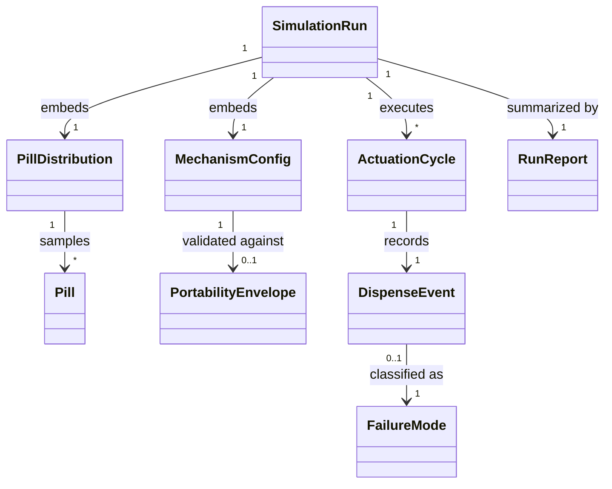

# Phase 1 Data Model: Dispensing Mechanism Simulation

**Feature**: 001-dispensing-mechanism-simulation | **Date**: 2026-09-19

All entities are Python dataclasses (stdlib) in `src/dispenser_sim/models/`. Physical quantities carry explicit units: mm, g, degrees, J (Constitution II).

## Pill

A single medication unit sampled from a Pill Distribution.

| Field | Type | Units | Validation |
|---|---|---|---|
| shape | enum: `ROUND_TABLET`, `OBLONG_CAPLET`, `CAPSULE` | — | required (FR-006) |
| length | float | mm | > 0; for round tablets equals diameter |
| width | float | mm | > 0; ≤ length |
| thickness | float | mm | > 0 |
| mass | float | g | > 0; within category range (FR-007) |
| friction_coefficient | float | — | 0 < μ ≤ documented max (FR-008) |
| orientation | float | degrees | 0–180, orientation of long axis at singulation (FR-008) |

Derived: 2D profile (circle or stadium), maximum transverse width at a given orientation.

## PillDistribution

Configurable statistical description of a pill population (FR-009).

| Field | Type | Validation |
|---|---|---|
| category_weights | map shape → probability | weights sum to 1; only supported shapes |
| size_ranges | per shape: min/max length, width, thickness | mins > 0; min ≤ max; within documented realistic range (R2) |
| mass_ranges | per shape: min/max mass | mins > 0; consistent with size ranges |
| friction_range | min/max μ | 0 < min ≤ max |
| orientation_distribution | uniform or clustered parameters | angles within 0–180° |
| reservoir_size | int | ≥ 0 |

## MechanismConfig (Candidate Design)

Parametric physical description of the dispensing mechanism (FR-003).

| Field | Type | Units | Validation |
|---|---|---|---|
| name | string | — | unique per comparison |
| reservoir_capacity | int | pills | > 0 |
| passage_clearance | float | mm | > 0; key singulation dimension |
| metering_geometry | map (stroke length, gate widths, angles) | mm, degrees | each value > 0 and within mechanism bounds |
| actuation_energy | float | J | > 0 |
| stroke_time | float | s | > 0 |
| tolerances | map parameter → ±mm | mm | ≥ 0 |
| overall_dimensions | (L, W, H) | mm | checked against envelope |
| mass | float | g | checked against envelope |
| simplifications | list[string] | — | each with physical justification (FR-005) |

Validation: configs violating the PortabilityEnvelope are refused or flagged with the specific constraint violated (FR-004).

## PortabilityEnvelope

Documented limits for a portable, battery-operated device (Constitution V).

| Field | Type | Units |
|---|---|---|
| max_dimensions | (L, W, H) | mm |
| max_mass | g | g |
| max_actuation_energy | J | J |

Values live in a version-controlled config file (`configs/portability_envelope.json`), not in code.

## ActuationCycle

One complete dispense attempt, rest → rest (FR-001). State machine:

`LOADED → PRESENTED → SINGULATED → RELEASED → RESET`

- Any stage can transition to `FAULT` (jam, interrupted stroke), after which the cycle still resolves to exactly one classified outcome (FR-002).
- A jam may persist across subsequent cycles until cleared; persistence is recorded on each affected cycle (spec edge case).

## DispenseEvent

Recorded outcome of one ActuationCycle.

| Field | Type | Validation |
|---|---|---|
| cycle_index | int | unique, 0..N-1, no gaps (SC-001) |
| pills_dispensed | int | ≥ 0 |
| outcome | enum: `SINGLE`, `ZERO_DOSE`, `MULTI_DOSE`, `NO_PILL_AVAILABLE` | exactly one (FR-002, FR-012) |
| failure_mode | enum or null | required iff outcome is ZERO_DOSE (pills available) or MULTI_DOSE (FR-014) |
| pill_state | snapshot of involved pill(s) | preserved for unclassified events |
| jam_persistent | bool | whether a jam carries into the next cycle |

## FailureMode

Named classification of a single-dose invariant violation (FR-013): `JAM`, `STACKING`, `DOUBLE_DROP`, `MISSED_DISPENSE`, `UNCLASSIFIED`. `UNCLASSIFIED` must retain the cycle's recorded state for analysis (FR-014). `NO_PILL_AVAILABLE` (empty reservoir) is an outcome, not a failure mode, and is excluded from violation counts (FR-012).

## SimulationRun

One seeded execution of N ActuationCycles for a given MechanismConfig + PillDistribution.

| Field | Type | Validation |
|---|---|---|
| run_id | string (uuid or digest) | unique |
| seed | int | recorded always (FR-015/017) |
| mechanism_config | MechanismConfig (embedded) | full copy for reproducibility |
| pill_distribution | PillDistribution (embedded) | full copy for reproducibility |
| envelope | PortabilityEnvelope (embedded) | as validated |
| cycles_requested / cycles_completed | int | equal on success (SC-001) |
| events | list[DispenseEvent] | length == cycles_completed |

## RunReport

Derived view over a SimulationRun (FR-018/019, SC-002):

- Totals: actuations, single-dose count/rate, zero-dose, multi-dose, no-pill-available.
- Aggregate single-dispense success rate + pass/fail vs 99.5% threshold.
- Per shape/size-category success rates.
- Failure-mode breakdown summing to 100% of violations (SC-003).

## Relationships

