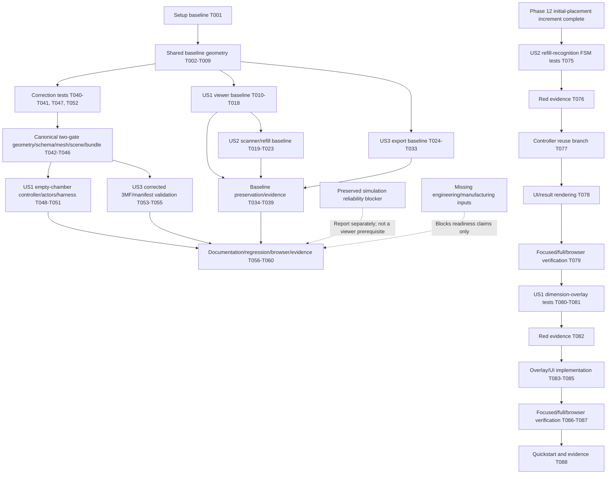
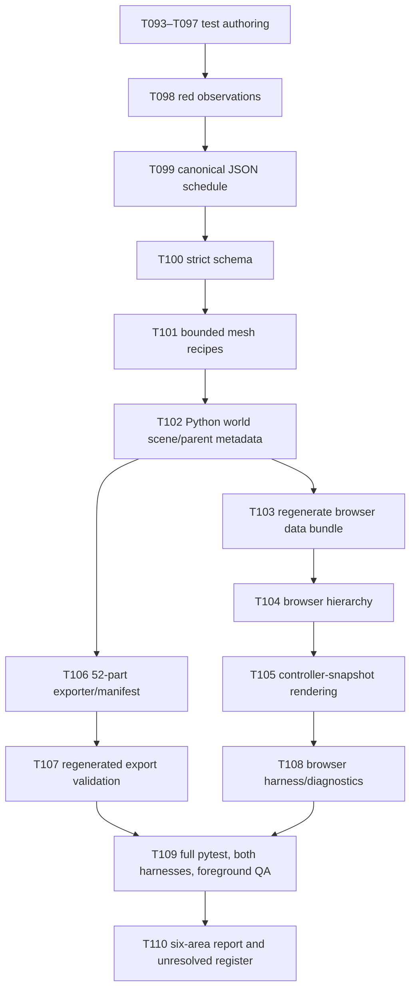
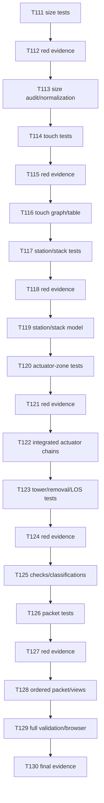

# Tasks: Portable Rotating-Cartridge Dispenser Visualization

**Feature**: 003-3d-mechanism-visualization | **Updated**: 2026-10-12 (ordered SC-026–SC-031 model-review phase added)

**Input**: [spec.md](spec.md), [plan.md](plan.md), [research.md](research.md), [data-model.md](data-model.md), [scene contract](contracts/scene-interface.md), [geometry contract](contracts/geometry-source-contract.md), [3MF contract](contracts/3mf-export-contract.md), [CLI contract](contracts/cli-contract.md), and [quickstart.md](quickstart.md).

**Tests**: Included because the spec/contracts require deterministic FSM behavior, shared geometry/provenance consistency, export integrity and preservation of features 001/002. Write the browser-native and pytest contract checks before their implementation. A real browser/WebGL check is separately required; unit tests cannot establish visual quality, `file://` compatibility, or FPS.

**Organization**: Setup → shared geometry foundation → US1 (P1 assembly viewer) → US2 (P1 scanner/refill/exchange) → US3 (P2 complete 3MF) → cross-cutting verification, followed by completed Phases 13–16, the preserved Phase 17 FR-034/SC-025 A–K schedule, and the new ordered Phase 18 SC-026–SC-031 review. The existing implementation tasks describe a delivered baseline, not conformance to the controlling two-gate correction. Phase 18 sequences source-size audit, touch chains, single-station stack, actuator zones, tower/LOS review, and the ordered report/browser evidence; the physical inventory remains exactly 52.

## Scope reset and observed implementation baseline

- This backlog replaces the 2026-10-06 slider-gate/run-replay backlog. The checked baseline tasks remain historical foundation, not feature convergence. Selected correction tasks T040–T046, T048–T050, T052–T057, and T059 have now been implemented and verified as recorded below; T047/T051 collision-detail checks, T058 complete foreground acceptance, and T060 traceability/convergence review remain open.
- Current implementation: `src/dispenser_sim/viz3d/geometry_schema.py`, `concept_geometry.json`, `mesh.py`, `scene.py`, `concept_export.py`, and `docs/visualizer/` now encode the selected local-Y top-wedge upper blade, separate lower tongue, initial empty chamber, persistent staged actor, guarded cycle, and self-contained export design basis. The user-selected Blade Y direction remains in conflict with perpendicular/X-tip wording in the supplied source; this is documented and not silently resolved.

- Remaining concrete gap: world-space AABB sampling shows overlap during the intended wedge contact/lift of pill 2 as the blade closes. The current AABB check is too conservative to distinguish contact from mesh penetration; a shape-aware rendered collision/contact check and recorded review are still required before T047/T051 can be checked. This does not establish a physical fit or clearance.
- Existing tests include `tests/unit/test_viz3d_geometry_source.py`, `test_viz3d_mesh.py`, `test_viz3d_scene.py`, `test_viz3d_scan_export.py`, `tests/integration/test_export_3mf_cli.py`, `test_feature003_regressions.py`, and `tests/browser/browser-tests.js`. Their current passing/history notes cover baseline behavior only; add targeted two-gate tests without weakening feature-001/002 simulation tests or changing persisted run records.
- The local static viewer, browser harness, canonical geometry/data generator and 32-instance concept exporter/manifest are present. The task is to correct and verify their two-gate behavior, not recreate the prior missing-artifact checklist. Prior browser and Python results remain attached to the old source revision and are not proof of current-spec convergence.
- Preserve the standard-library-only Python core, local/offline Three.js runtime, non-editable install workaround and `pythonpath=["src"]` pytest setting. Keep the retired pyglet/run-driven 3D viewer retired and retain the feature-002 2D player.
- Preserve features 001/002, simulation behavior, saved run data, seeded determinism, and the 2D player. The known single-dose reliability blocker remains separately disclosed; this visual demo is not evidence or a waiver. Every 3MF must retain `NOT VALIDATED`, `NOT PRINT-READY`, `print_ready=false`, and `fabricable_as_designed=false`.
- Current correction evidence is appended under “Correction pass: selected Blade Y, empty chamber, and outlet path” in `implementation-evidence.md`; earlier dated sections describe superseded behavior. The current browser-native harness reports 30 passed and the full Python suite 138 passed, but neither alone establishes collision clearance, 60-second performance, slicer interoperability, physical validation or convergence.

## Format and execution rules

Every task follows `- [ ] Tnnn [P?] [USn?] action ...exact/path...` while pending or `- [x]` when its described work/evidence is actually complete. `[P]` is used only for tasks that can proceed in parallel against distinct files after their dependencies are ready. Story labels are present only in user-story phases. Preserve checked baseline tasks honestly; do not mark the new correction tasks complete until verified. Do not edit `build/lib/` as source.

## Phase 1: Setup — preserve the current-state baseline

**Purpose**: Capture the exact before-state for safe replacement while distinguishing reusable code from obsolete feature-003 implementation. No application feature work is included here.

- [x] T001 Record the inspected legacy/reusable/missing file inventory, active feature and branch, relevant saved-run hashes and the existing reliability findings in `specs/003-3d-mechanism-visualization/implementation-evidence.md`; label tests and browser/performance evidence as not yet run, and do not treat the known reliability blocker as permission to change or conceal simulation behavior.

## Phase 2: Foundational — canonical shared geometry and mesh adapters

**Purpose**: Establish one versioned source for browser and Python geometry/export. This phase blocks all user stories; it does not authorize manufacturing claims.

- [ ] T002 [P] Add source-schema and generated-bundle contract tests in `tests/unit/test_viz3d_geometry_source.py` for required root fields, schema/revision rejection, stable IDs, finite values, explicit provenance/status, null missing values, exact 32-instance physical inventory, demo-only exclusions, canonical source hash, deterministic generated-JS equality, and no slider-era part identities.
- [ ] T003 [P] Expand mesh/coordinate contract tests in `tests/unit/test_viz3d_mesh.py` for deterministic box/cylinder/cone/extrusion/lathe-profile/helix recipes, finite vertices and valid triangles, bounded topology results, local-to-assembly transforms, right-handed scan/canonical/Three basis conversion, signed basis vectors, and nonidentity rotation/translation round trips.
- [ ] T004 [P] Replace slider-only scene assertions with scan-concept assembly tests in `tests/unit/test_viz3d_scene.py`: assert the ordered 32 physical names and unique IDs, 4-way cartridge identities/placements, fixed parked pose, shared source dimensions/provenance, explicit unknowns, expected component/recipe links, and no inferred overall device envelope.
- [x] T005 Define the versioned canonical geometry, provenance, display palette, fixed demo fixtures/timings, coordinate frames, 32 physical component recipes/placements, missing-input records, export policy and demo-only exclusions in `src/dispenser_sim/viz3d/concept_geometry.json`; preserve every scan value as concept-only and keep unknown numeric values null. This is the prior scan-derived baseline; the correction source is T042.
- [x] T006 Implement strict stdlib source loading, canonical hashing/serialization, schema/provenance/transform validation, and fail-closed error reporting in `src/dispenser_sim/viz3d/geometry_schema.py`; configure `pyproject.toml` package data so the JSON is available through package resources after a non-editable install. Revised provenance/recipes remain pending T043.
- [x] T007 Extend `src/dispenser_sim/viz3d/mesh.py` with deterministic recipe-to-mesh adapters for the prior geometry contract's bounded primitives and explicit coordinate transforms; reuse existing helpers where sound, reject unsupported/invalid recipes, and report structural QA as artifact-only rather than manufacturing validation. The wedge profile remains pending T044.
- [x] T008 Replace the slider/run-config implementation in `src/dispenser_sim/viz3d/scene.py` with a source-driven parked concept assembly builder that returns all 32 separate physical instances, meshes, transforms, dimension/provenance/missing-input records and stable order from the canonical JSON; do not depend on run records or mechanism configs. Corrected station/chamber placement remains pending T045.
- [x] T009 Add `tools/build_visualizer_data.py` to validate the package source and deterministically emit `docs/visualizer/concept-data.js` as a classic-script global containing the source hash/schema metadata; verify generated bytes against T002 and never hand-edit the generated bundle. Regeneration after the two-gate source correction remains pending T046.

**Checkpoint (baseline only)**: The prior Python/browser inputs resolve from the package JSON and agree on their existing units, IDs, provenance and rest transforms. This checkpoint does not certify the controlling station geometry; T042–T046 establish corrected source/bundle agreement. Neither checkpoint establishes mechanical or manufacturing validation.

## Phase 3: User Story 1 — inspect and operate the complete concept assembly (Priority: P1)

**Goal**: Recreate the scan as a recognizable offline Three.js browser artifact: four radial removable color-coded cartridges, central post/drum, individual upper blades/tabs/springs, pin/solenoid/carriage/rails, servo/crank/rod, shared lower tongue and outlet tray. Operate a deterministic dispense demo with no simulation-run dependency.

**Independent Test**: Open `docs/visualizer/index.html` directly without a simulation run or network. Verify all named subassemblies and assumed five-pill stacks, orbit/zoom and status controls, repeatable single-color requests following the named mechanism state order, pin-up/carriage-park rotation interlock, unchanged idle state while RAF renders, and an actionable WebGL failure message.

- [x] T010 [P] [US1] Vendor the pinned official Three.js r128 UMD/classic build at `docs/visualizer/vendor/three-r128.min.js` and retain its complete upstream MIT notice at `docs/visualizer/vendor/THREE-LICENSE.txt`; record the reviewed upstream version/source and verify no runtime CDN or package-manager dependency is introduced.
- [x] T011 [P] [US1] Create the semantic static viewer shell in `docs/visualizer/index.html`, loading only relative classic scripts and stylesheet; include an accessible scene/canvas/fallback region, persistent concept/non-validation disclosure, all required color/schedule/speed/visibility controls, cartridge/cap/refill/scan control slots, and the live status region.
- [x] T012 [P] [US1] Create responsive desktop/mobile layout, accessible focus/touch targets, scene sizing and reduced-motion UI treatment in `docs/visualizer/styles.css`; support the documented 1440px desktop and 390px phone viewport without relying on external fonts or assets.
- [x] T013 [P] [US1] Create the browser-native contract harness in `tests/browser/index.html` and `tests/browser/browser-tests.js`; load only local classic scripts and provide deterministic assertions/reporting without Node, npm, modules, server, test framework or network access.
- [x] T014 [P] [US1] Build the retained Three.js scene in `docs/visualizer/app.js` from `DISPENSER_CONCEPT_DATA`: create recognizable geometry/materials and stable named component objects, perspective camera and lighting, explicit source-to-Three basis mapping, capped-DPR resize handling, pointer orbit/wheel/pinch zoom, and actionable graceful WebGL initialization/context failure handling.
- [x] T015 [P] [US1] Implement the prior DOM-independent deterministic dispense FSM in `docs/visualizer/demo-controller.js`, including named states, speed bounds, the prior sequence's interlocks/count events, schedule once/repeat/depletion, safe reset, elapsed-time carry-over and immutable/reproducible snapshots. This baseline creates the pill at the blade-pull phase and does not prove the corrected empty-chamber cycle; replace that behavior in T048.
- [x] T016 [US1] Implement retained Three.js object transforms and deterministic actor animation in `docs/visualizer/app.js` from controller snapshots for the prior phase sequence; corrected staged-identity and vertical fall visuals remain pending T049.
- [x] T017 [US1] Bind semantic dispense, six-request schedule, once/repeat, safe reset, speed, cap-visibility and labels controls to `docs/visualizer/app.js`; expose the prior phase/status fields and permanent concept-only disclosure. Corrected station/gate status remains pending T050.
- [x] T018 [US1] Extend `tests/browser/browser-tests.js` with the prior selected-color rotation, station/gate/pin-axis registration, phase endpoint, upper/lower sequencing, separator-gap, tangent-axis and pill-transfer assertions; the recorded 21-check run is historical baseline evidence only. It does not test an empty chamber at rest, persistent identity from the cartridge stack, both command-level interlock directions, the corrected dwell order, blade/tongue collision, or convergence to FR-004–FR-008; those checks are pending T047–T051.

**Checkpoint**: US1 can be assessed from the local browser page itself; passing FSM tests is not a substitute for the real-browser visual check in the final verification phase.

## Phase 4: User Story 2 — scan, unlock, refill and exchange cartridges (Priority: P1)

**Goal**: Recreate the scan package/beam and cap workflow with exact illustrative barcode fixtures, 20-second wall-clock unlock, refill and cartridge removal/insertion while preserving count and serializing unsafe actions.

**Independent Test**: From the idle viewer, scan each of the four known codes and the unknown code; confirm only the matching cap unlocks, unknown grants none, close/timeout relocks correctly, locked caps refuse opening, fill is limited to five assumed pills, open caps block dispensing, and cartridge exchange preserves inventory. Busy operations must reject incompatible actions with a visible reason.

- [x] T019 [P] [US2] Extend `tests/browser/browser-tests.js` with US2 cases for exact barcode fixtures, wall-clock unlock expiry, unknown-scan behavior, cap open/close/fill, open-cap blockers, cartridge presence/count preservation, and incompatible-operation rejection.
- [x] T020 [US2] Implement serialized scanner, barcode mapping, cap lock/open/easing, refill, cartridge presence/lift, expiry and safe-reset interactions in `docs/visualizer/demo-controller.js`; preserve the previous unrelated valid unlock on unknown scan, preserve counts across cartridge exchange, cap refill at five and keep all behaviors in-memory/demo-only.
- [x] T021 [US2] Add deterministic package-in/beam/result/out and cartridge lift/insert animation actors in `docs/visualizer/app.js`, bound to controller phases and existing retained objects; do not add network image/barcode dependencies or alter the physical export geometry.
- [x] T022 [US2] Bind all barcode, cap, fill and remove/insert controls in `docs/visualizer/app.js` to controller guards and accessible status announcements; show exact scan result, unlock timer, cap/scanner state and rejection reason without presenting barcode fixtures as medication verification.
- [x] T023 [US2] Run the prior browser-native contract harness from `tests/browser/index.html`; its recorded 21-check pass and four-color AABB sampling validate the then-current transfer sequence only. A pill-vs-selected-blade AABB check is not a blade-vs-tongue collision test or a formal mutual-interlock test, and this run predates the controlling empty-chamber order, persistent staging identity, top-wedge/lower-floor geometry and all-state rendered gate invariant. Re-run the corrected requirements through T047–T051 and foreground evidence; do not treat T023 as spec convergence.

**Checkpoint**: Scanner and cartridge workflows work independently of Python runs and do not alter the simulation, persisted records or the parked export model.

## Phase 5: User Story 3 — export a clearly limited complete concept assembly (Priority: P2)

**Goal**: Generate a deterministic headless stdlib 3MF Core package and mandatory sibling manifest for all 32 physical scan-concept instances in one parked/rest assembly, with hashes, complete provenance, fail-closed path safety and immutable non-readiness declarations.

**Independent Test**: Run `dispenser-sim export-3mf --output PATH.3mf` outside protected trees without a run/config/display/browser dependency. Inspect 32 unique named meshes plus one assembly object and one build item, right-handed millimetre placements, canonical-source correspondence, manifest component inputs/unknowns/hashes and all mandatory false readiness fields. Verify unsafe paths and injected handled failures do not silently publish a partial replacement.

- [x] T024 [P] [US3] Add concept export contract tests in `tests/unit/test_viz3d_scan_export.py`: assert 32 named mesh resources plus one root/32 refs/one build item, stable Core package bytes, false readiness fields, hashes and run-free publication.
- [x] T025 [P] [US3] Add destination collision, `--force`, project-tree, symlink, hardlink-alias and handled replacement-failure coverage in `tests/unit/test_viz3d_scan_export.py`; retain the explicit non-crash-atomic pair limitation.
- [x] T026 [P] [US3] Add CLI contract tests in `tests/integration/test_export_3mf_cli.py` for required `--output`, missing output usage, protected destination, no `--run` source, warnings, and preservation of 2D `animate`.
- [x] T027 [US3] Implement the deterministic concept 3MF Core writer in `src/dispenser_sim/viz3d/concept_export.py` using `geometry_schema.py`, `mesh.py` and `scene.py`; emit 32 separately identified meshes, one portable concept assembly object, one build item, fixed parked/rest transforms, millimetre/right-handed metadata, valid OPC relationships and deterministic ZIP/XML. Corrected gate recipes remain pending T053.
- [x] T028 [US3] Implement the canonical JSON manifest in `src/dispenser_sim/viz3d/concept_export.py` with source/schema/generator hashes, all 32 names/IDs/recipes/transforms/bounds, provenance/missing inputs, scan caveats, exclusions, structural QA, manufacturing blockers, package and self-excluding manifest hashes, and fixed false readiness declarations. Two-gate source details and regenerated hashes remain pending T054.
- [x] T029 [US3] Implement staged publication, pair validation and handled-error rollback in `src/dispenser_sim/viz3d/concept_export.py`; reject project/source/run descendants, symlinks and hardlinks even with `--force`, and disclose the pair is not crash-atomic.
- [x] T030 [US3] Replace the legacy CLI path in `src/dispenser_sim/cli.py`: remove `animate --3d` while preserving feature-002 `animate`; add `export-3mf --output PATH.3mf [--force]` with canonical package-resource input and mandatory warnings.
- [x] T031 [US3] Retire the obsolete feature-003 Python replay and run-bound export modules/tests; remove the unused `viz` extra and preserve canonical geometry, mesh/scene/export code, features 001/002 and the 2D tests.
- [x] T032 [US3] Run geometry/export/CLI tests, independently validate a generated 32-instance package+manifest and record actual command/results in `specs/003-3d-mechanism-visualization/implementation-evidence.md` without changing readiness flags. This verifies the prior source only; corrected geometry/hash validation is pending T055.
- [ ] T033 [US3] Record optional 3MF-viewer interoperability in `docs/feature-003-3mf-interoperability.md`: inspect a generated disposable package in an available 3MF-capable application, record application/version and observed identity/placement/metadata behavior, or explicitly state not tested if no suitable application is available; do not equate this with printability.

**Checkpoint**: A technically valid package is still only a scan-derived concept. Missing authoritative geometry, interfaces, materials, actuators/springs, clearances and tolerances remain visible blockers.

## Phase 6: Polish and cross-cutting preservation/evidence

**Purpose**: Verify the actual browser artifact, offline/dependency boundary, feature-001/002 preservation and truthful end-state reporting.

- [x] T034 [P] Add `tests/integration/test_feature003_regressions.py` to verify core validate/run/report/compare and seeded outcomes remain unchanged, the feature-002 2D `animate` behavior still works, persisted records are not mutated, the new exporter is run-independent, and no pyglet/browser/Three.js/network dependency enters Python core/export paths.
- [x] T035 [P] Update `README.md` and `docs/mechanism_model.md` to describe the actual static viewer entry point, local/offline requirements, demo-only limits, new export command, preserved 2D workflow, unknown design inputs and mandatory 3MF non-readiness; this earlier documentation does not yet describe the corrected station/cycle, which is pending T056.
- [x] T036 Install Python source non-editably and run `tests/`, including unit/statistical/integration groups; final prior-source result: **128 passed** on 2026-10-10. Simulation/reliability assertions remain unchanged; rerun after conformance changes in T057.
- [ ] T037 Open the workspace-local `docs/visualizer/index.html` directly in a foreground real browser with network disabled; verify WebGL/local script loading, no external requests or console errors, every US1/US2 control at 1440px desktop and 390px phone widths, touch/keyboard/status behavior, deterministic repeat, no idle drift and actionable unsupported-WebGL fallback. After T051 also verify the initial empty chamber, exact corrected sequence, all four colors, both gate guards, vertical pill falls and persistent visibility of non-selected compartments; record browser/device/OS/GPU/DPR and evidence or limitations in `docs/performance/feature-003-browser.md`.
- [ ] T038 Measure the real browser scene's idle and ordinary-camera rendered FPS against SC-009 and record the method, viewport, warm-up/capture interval, browser/device/OS/GPU/DPR and actual results in `docs/performance/feature-003-browser.md`; report target met/unmet or unavailable honestly, never infer FPS from unit tests.
- [ ] T039 Complete the baseline FR/SC traceability and status review in `specs/003-3d-mechanism-visualization/implementation-evidence.md`; link only evidence actually available, mark two-gate FR-004–FR-008 conformance as pending until T060's final review, confirm preserved run and 2D behavior, and keep Constitution I and manufacturing gates blocked unless separately resolved through authorized evidence/workflow. This is not a feature-convergence sign-off.

## Phase 7: Foundational correction — controlling two-gate station geometry

**Purpose**: Correct the shared geometry authority before changing browser motion or export outputs. The channel/outlet/chamber are concept inputs, the pill/channel axis assignment remains an assumption, and every value stays `NOT_VALIDATED`.

- [x] T040 [P] Add conformance tests in `tests/unit/test_viz3d_geometry_source.py` for the distinct `USER_SPECIFIED` provenance value, exact channel/outlet/chamber dimensions and specified axes, parked empty chamber, blade/tongue datum and travel, fixed 32-instance inventory, null unknown fits, and immutable non-readiness fields; include negative cases for missing provenance, wrong axes, non-null missing values, and accidental validation promotion.
- [x] T041 [P] Add mesh/scene contract tests in `tests/unit/test_viz3d_mesh.py` and `tests/unit/test_viz3d_scene.py` for a flat-bottom/top-only wedge blade profile (0.3→1.0 mm over 2.6 mm), approximately 10.5×22×1 mm concept envelope, blade local-Y travel, separate tongue floor bounds z=−1.5..0 mm and canonical-Y travel, station channel/outlet/chamber placements, empty-at-rest geometry, and bounded parked blade/tongue transforms; label these bounded geometry checks as non-physical QA. Mid-cycle wedge-contact/collision proof remains separate in T047/T051.
- [x] T042 Record controlling two-gate source provenance and the complete station dimensions/assumptions in `src/dispenser_sim/viz3d/concept_geometry.json`: channel 10.8 mm X × 8.4 mm Y, assumed pill 10 mm X × 7 mm Y × 5 mm Z, outlet aperture 11.8×9.4 mm without inventing an unspecified axis order, chamber z=0..5 mm, closed tongue plate z=−1.5..0 mm, lowest parked pill bottom near z=6 mm, 24 mm tongue with +5.7/−5.7 mm leading-edge endpoints and 11.4 mm Y travel, and 10.4 mm blade stroke from signed local-Y tip offsets −5.2 to +5.2 mm. Add explicit `USER_SPECIFIED` source attribution distinct from scan provenance, channel/pill axis-order assumption, derivation revisions, and null fit/flexure/spring/force/friction/tolerance unknowns without changing the 32 physical identities or false readiness flags. Preserve the user's explicit Blade Y choice and disclose the source's perpendicular-axis/X-tip conflict.
- [x] T043 Extend fail-closed parsing/schema checks in `src/dispenser_sim/viz3d/geometry_schema.py` to accept and validate the controlling-user-spec provenance, reject invalid/missing station dimensions and unknown recipe/profile versions, enforce `NOT_VALIDATED`, and verify the exact 32-part identities plus fixed `print_ready=false` and `fabricable_as_designed=false` declarations.
- [x] T044 Add deterministic Python mesh adapters in `src/dispenser_sim/viz3d/mesh.py` for a blade with a flat underside and top-only nose wedge, preserving the tab/slot as part of its named physical instance, plus a distinct flat lower-tongue plate; expose local bounds/axes so profile and travel tests can assert shape without claiming clearance or manufacturability.
- [x] T045 Update the canonical parked assembly builder in `src/dispenser_sim/viz3d/scene.py` to place channel, outlet and chamber against the specified datums; keep the upper blade at the pill-seam elevation and shared tongue as the separate lower Y-slide floor; test exact source-to-assembly transforms, zero initial chamber occupancy and bounded parked blade/tongue separation while retaining all 32 names and export rest pose.
- [x] T046 Regenerate `docs/visualizer/concept-data.js` with `tools/build_visualizer_data.py`; verify the bundle's canonical source hash, schema/generator revision, station dimensions, blade/tongue recipes and byte-for-byte deterministic regeneration from the package JSON.

**Checkpoint**: One canonical source and its generated browser bundle describe the corrected two-gate station. Python mesh/scene tests establish only bounded shape/transform consistency, not fit or physical validation.

## Phase 8: User Story 1 — empty-chamber cycle, strict interlock and actors (Priority: P1)

**Goal**: Replace the prior preloaded-pill/current phase sequence with the controlling empty-chamber cycle. A stable pill identity starts in the selected cartridge stack, stages on the closed tongue only after blade opening and a vertical ~6 mm fall, persists through blade closure/dwell, then falls vertically through the outlet after the tongue opens.

**Independent Test**: For RED, BLUE, GREEN and ORANGE from explicit assumed loaded demo state after scan/refill setup, verify zero initial chamber occupancy and no staged identity; observe the exact upper-blade → pill-land → wedge-close/lift → 0.3 s closed dwell → pin-up/carriage-park → lower-tongue release → visible-clear → tongue-return order. Each cycle keeps every non-selected compartment visible, preserves one pill ID with one decrement at landing and one tray increment at release completion, and rejects both unsafe gate directions without state/count/actor mutation.

- [ ] T047 [P] [US1] Extend `tests/browser/browser-tests.js` with the controlling order and invariants: empty chamber and `pill=null` at park; stack-bottom actor falls ~6 mm only after blade-open to the still-closed tongue; same cartridge/index identity persists through stage/dwell/vertical outlet fall; count changes exactly once at landing and tray count once at clear; blade closes with ~1 mm upper-stack lift and fully-closed 0.3 s dwell before pin lift; direct attempts to move the blade while tongue is open/moving and tongue while selected blade is open/moving are refused; sample rendered blade–tongue and blade–pill bounds through the full cycle for unintended intersections; no sampled state has both gates open/moving; all four colors run; no unselected cartridge/pill actor is hidden.
- [x] T048 [US1] Refactor `docs/visualizer/demo-controller.js` so reset begins `PARKED` with no staged/chamber pill and bottom pill in the above-blade stack; implement named transitions in spec order, landing-triggered stable pill identity/count decrement, blade-close wedge/stack-lift state and 0.3 s closed dwell before pin/carriage retraction, then tongue release/clear/return and single tray increment. Enforce blade-motion→tongue-fully-closed and tongue-motion→selected-blade-fully-closed guards at command and transition levels; rejected operations preserve gates, inventory and actor identity, and large deltas cannot skip endpoints/dwells/interlocks.
- [x] T049 [US1] Update actor placement and animation in `docs/visualizer/app.js` to source all 20 assumed pill actors from the centers of their cartridge channels, keep the chamber empty at park, move the selected bottom actor vertically down to the tongue after blade-open, preserve that actor identity while staged, then move it vertically through the outlet to tray-floor height before translating laterally to its tray slot; do not reuse pill actors or hide other compartments, and keep camera/RAF behavior independent of controller state. Rendered AABB sampling found intended wedge/next-pill overlap during close; distinguish designed contact from penetration in open T047/T051.
- [x] T050 [US1] Drive upper-blade and lower-tongue meshes in `docs/visualizer/app.js` only from guarded controller snapshots: blade local short-width Y direction slides along the selected station's outward radial Y axis through its 10.4 mm stroke; shared tongue moves on canonical Y while remaining at z=−1.5..0 mm (mapping to Three world +Z once); freeze a gate at its closed transform if its counterpart is not fully closed, and report corrected phase, blade-tip local-Y position, tongue-edge and actor states in the UI.
- [ ] T051 [US1] Run and correct the browser-native harness at `tests/browser/index.html` after T048–T050; record the actual revised assertion count/result in `specs/003-3d-mechanism-visualization/implementation-evidence.md`, including both rejection directions, all four color traces, sampled blade–tongue and blade–pill collision checks, gate-motion exclusivity, actor identity/count invariants, no other-compartment hiding, and visible dwell/vertical fall checkpoints. A passing harness is software evidence only.

**Checkpoint**: The model and renderer depict the exact deterministic two-gate concept cycle without overlapping gate motion. This is not single-dose or hardware validation.

## Phase 9: User Story 3 — corrected concept export and manifest (Priority: P2)

**Goal**: Regenerate the 32-instance parked 3MF and sibling manifest from the corrected canonical geometry while retaining safe publication, source hashes and immutable non-readiness declarations.

**Independent Test**: Export from canonical package data and inspect the same corrected blade profile, lower tongue floor and parked transforms as the browser source; verify one right-handed millimetre assembly/build item, 32 stable separately named physical instances, manifest provenance/unknowns/hashes and all false readiness flags. Export success is not evidence of printability or fit.

- [x] T052 [P] [US3] Extend `tests/unit/test_viz3d_scan_export.py` to assert 32 unchanged named physical parts, corrected wedge-blade and lower-tongue mesh bounds/placements, empty chamber at parked rest, source/recipe/derivation hashes, controlling-spec provenance and axis assumption, explicit null unknowns, and package/manifest/component `NOT_VALIDATED`, `print_ready=false`, `fabricable_as_designed=false`; fail if QA changes any readiness declaration.
- [x] T053 [US3] Update `src/dispenser_sim/viz3d/concept_export.py` to serialize the revised blade and tongue recipes/transforms from `geometry_schema.py`, `mesh.py` and `scene.py` into the existing single assembly/build item; preserve 32 stable physical names, parked rest pose, right-handed millimetres, exclusions and staged/hash-validated safe pair publication.
- [x] T054 [US3] Update manifest construction and validation in `src/dispenser_sim/viz3d/concept_export.py` to include corrected per-instance source provenance, full `design_basis` with station/axis assumptions, controlling-spec provenance, coordinate frames and derivation rules, explicit null unknowns, and exact source/generator/package/self-excluding manifest hashes; enforce all four mandatory warning/readiness literals and retain pair-not-crash-atomic disclosure.
- [x] T055 [US3] Run `tests/unit/test_viz3d_scan_export.py` and `tests/integration/test_export_3mf_cli.py`, generate a disposable run-independent 3MF outside protected source/run trees, re-open and validate the package/manifest, compare blade/tongue geometry and rest transforms to canonical JSON, and record exact results in `specs/003-3d-mechanism-visualization/implementation-evidence.md`; do not edit the exporter into readiness.

**Checkpoint**: The browser and 3MF use the same corrected canonical source and disclose the concept-only status. External 3MF interoperability remains a separate task (T033).

## Phase 10: Polish — documentation, evidence and status

**Purpose**: Update user guidance to the controlling cycle, rerun regressions, and capture actual foreground-browser evidence without treating software checks as mechanical proof.

- [x] T056 Update `README.md`, `docs/mechanism_model.md`, and `specs/003-3d-mechanism-visualization/quickstart.md` to describe the empty parked chamber, upper top-wedge sliding separator, separate lower Y-slide tongue floor, strict mutual interlock, exact cycle/count boundaries, vertical pill path, axis assumption, missing fits/forces/tolerances, generated canonical browser bundle and immutable 3MF non-readiness; remove any remaining preloaded-pill or obsolete phase-order description.
- [x] T057 Install Python source non-editably and run the full `tests/` suite after T042–T055, including feature-001/002 regression and existing saved-run checks; record the actual command/result and any failure in `specs/003-3d-mechanism-visualization/implementation-evidence.md`, without changing simulator behavior or reliability criteria.
- [ ] T058 Open the workspace-local `docs/visualizer/index.html` in a foreground real browser with network disabled at 1440px desktop and 390px phone widths; capture actual scene/controller evidence for all four colors, empty-at-rest chamber, wedge entry/stack lift, both interlock refusal directions, blade/tongue non-overlap, exact dwell order, stable actor identity and vertical outlet fall, no other-compartment hiding, `file://` asset loading and no console errors in `docs/performance/feature-003-browser.md`.
- [x] T059 Update `specs/003-3d-mechanism-visualization/implementation-evidence.md` with corrected canonical/browser/3MF hashes, test outputs, browser/device/viewport/DPR/GPU details and links to captured evidence; explicitly distinguish controller tests, rendered-world checks, package QA and pending FPS/slicer/manufacturing checks.
- [ ] T060 Reconcile FR-001–FR-024 and SC-001–SC-012 against the actual artifacts/evidence in `specs/003-3d-mechanism-visualization/implementation-evidence.md`; keep any untested desktop/mobile/FPS/interoperability criteria pending, retain Constitution I and manufacturing blockers, and make no feature-converged, single-dose, physical-validation, print-ready or fabricable-as-designed claim.

## Dependencies and execution order

### Phase and story graph

- T001 records baseline before code retirement. T002–T004 are independent test-authoring tasks against separate files. T005–T008 establish the prior scan source, adapters and assembly in order; T009 emits the prior generated bundle. These checked baseline tasks do not satisfy the correction tasks.
- US1 vendor, semantic shell, stylesheet and browser harness (T010–T013) can be prepared in parallel after the shared contract is frozen. `app.js` scene setup (T014) and DOM-independent `demo-controller.js` (T015) can proceed in parallel; animation and bindings (T016–T018) join them.
- US2 browser tests T019 can be authored separately before controller work. T020 changes the controller and depends on US1; T021/T022 integrate visuals and controls in `app.js` sequentially, then T023 executes the story harness.
- US3 tests T024–T026 can proceed in parallel in distinct files after the geometry contract. Export writer T027 → manifest T028 → transaction T029 → CLI T030; T031 removes only callers proven obsolete; T032 validates the assembled implementation. US3 needs the shared geometry foundation but does not depend on US1/US2 acceptance, so separate workers may start it after T009. Serialize edits to `cli.py`, `pyproject.toml`, `__init__.py`, and shared evidence files.
- T034 and T035 were separate baseline files. For the correction, T040, T041, T047 and T052 author independent Python geometry, browser FSM and export tests; after T042/T043, T044 mesh work precedes T045 scene construction and T046 bundle regeneration.
- After T046, corrected US1 work (T048–T051) and US3 export work (T053–T055) can proceed in parallel because they consume the same frozen source but edit different controller/browser and exporter/test files. T047/T052 can be authored before implementation; do not merge these branches until the canonical source is stable.
- T056 follows the corrected behavior and export source. Run the full suite (T057) after code/tests stabilize; perform real foreground validation (T037/T058) and FPS capture (T038) in separate browser sessions; update evidence (T059) and complete the non-convergent status review (T060) last. T033 remains an optional external 3MF interoperability check.
- Phase 13 is a separate follow-on to the completed Phase 12 initial-placement increment and amended spec/plan. Execute T075 (FSM tests) → T076 (capture and record actual red results) before any implementation; then T077 (controller branch) → T078 (app/result rendering) → T079 (focused/full/browser verification and evidence/quickstart update as applicable). Preserve the no-container initial-placement path and all refusal, scanner-isolation, simulator, Feature 004, geometry/export and readiness boundaries.
- Phase 14 adds the approved FR-031/SC-019 dimension overlay as a test-first US1 increment. Its completed tests/evidence are historical to that phase's 32-part baseline and earlier 12.8 × 10.4 × 40 mm cartridge recipe; Phase 18 supersedes those inventory/size assumptions with the exact 52-instance target and current 14.8 × 12.4 × 40 mm requested cartridge envelope. T080–T088 remain historical evidence and must not be rewritten as if they tested the later requirements. Never derive values/endpoints from rendered bounds or invent tray height/unknowns.
- Do not edit `build/lib/`, rewrite saved runs, alter the simulator to make the visual demo appear successful, or turn mesh/package QA into physical validation.

### Parallel opportunities

- **Foundation**: T002–T004 and correction tests T040–T041 are separate Python files; T047 (browser harness) and T052 (export tests) can also be authored independently against the controlling requirements. Implement T042→T043→T044→T045, then regenerate the bundle in T046.
- **US1**: T010 vendor, T011 shell, T012 stylesheet, and T013 browser harness are separate assets; after these, T014 scene initialization and T015 controller are separate-file parallel work.
- **US2**: T019 browser FSM tests can be drafted while US1 is implemented; controller and renderer changes are sequential because the latter consumes the former's snapshot contract.
- **Refill-recognition follow-on (US2)**: T075–T079 are intentionally sequential because tests must be observed red before implementation, controller snapshots drive UI rendering, and browser/evidence validation follows both changes. There are no independent parallel tasks within this five-task increment. T075 may be scheduled alongside unrelated work that does not edit `tests/browser/browser-tests.js` or start conflicting browser validation.
- **Dimension-overlay follow-on (US1)**: T080 and T081 are parallel test-authoring tasks in separate static-test and browser-harness files; both must reach and have their actual red results recorded by T082 before implementation. Afterward T083 (`app.js` overlay construction) and T084 (HTML/CSS checkbox, metadata legend and accessible copy) can proceed in parallel in distinct files; T085 binds the control after both. T086–T088 are ordered, and real-browser sessions must not be parallelized with competing browser/performance work.
- **US3**: Baseline T024–T026 tests were separate files. Correction test authoring T052 can run in parallel with T047; after T046, T053/T054 update the exporter/manifest serially and T055 validates them. US3 correction work is independent of the US1 controller branch after the shared foundation.
- **Cross-cutting**: T056 documentation, T057 pytest, T058 foreground browser checks and T059 evidence updates are separate deliverables but depend on the relevant implementation outputs. Do not parallelize browser performance capture with other resource-heavy browser sessions.

## Implementation strategy

1. **MVP viewer increment**: complete setup + corrected shared geometry foundation + US1 empty-chamber/two-gate implementation, then independently verify the real static viewer from `file://` and all four deterministic color cycles. This does not satisfy the project's separate reliability gate.
2. **Interaction increment**: add US2 scan/cap/refill/exchange workflows and rerun the browser-native harness and actual browser scenarios.
3. **Export increment**: complete US3 full 32-instance assembly, manifest, CLI and handled-failure safety; it can be implemented in parallel after the shared foundation but remains P2 in delivery priority.
4. **Preservation and evidence**: complete cross-feature tests, non-editable install/full pytest, offline desktop/mobile browser checks, actual FPS measurement and evidence traceability. Any unavailable evidence remains pending/unmet.
5. **Separate boundaries**: deterministic demo behavior is not persisted simulation evidence, measured hardware operation, medication identity, dosing validation, print readiness or fabricability. Preserve the known reliability and manufacturing blockers; no task authorizes a waiver.

## Requirement coverage and backlog counts

| Scope | Tasks | Count | Acceptance coverage |
|---|---|---:|---|
| Setup | T001 | 1 | Existing-vs-required audit and truthful baseline |
| Foundation | T002–T009, T040–T046 | 15 | Baseline plus corrected canonical JSON/schema, station/channel/outlet/chamber, wedge/tongue meshes/transforms and generated browser data |
| US1 (P1) | T010–T018, T047–T051, T080–T092, T104–T105, T108 | 30 | Baseline viewer plus corrected cycle/interlocks, FR-031/SC-019 dimension overlay, FR-032/SC-023 main-view assembly visibility, FR-033/SC-024 tongue spring path, and browser assembly hierarchy/motion verification |
| US2 (P1) | T019–T023, T061–T064, T065–T079 | 24 | FR-014–017, FR-025–030; scan/cap/refill/exchange plus exact RED/BLUE/GREEN/ORANGE fixtures, empty startup, matching-only initial placement, existing-container refill recognition, preserved-state refusals and isolated main-scene scanner |
| US3 (P2) | T024–T033, T052–T055, T097, T106–T107 | 17 | Baseline plus corrected 52-instance assembly, manifest provenance/hashes/readiness, run-independent CLI export validation and preserved transaction/path guarantees |
| US4 (P2) | T093–T096, T098–T103, T111–T130 | 30 | Preserved Phase 17 A–K station-root work plus ordered SC-026–SC-031 size, touch-chain, single-station, actuator-zone, tower/LOS, and review-packet verification |
| Polish | T034–T039, T056–T060, T109–T110 | 13 | Preservation, full regression, foreground browser evidence, performance, explicit six-area PASS/FAIL report and non-claims |
| **Total** | **T001–T130** | **130** | 91 tasks checked; 39 pending, including 10 remaining Phase 17 tasks, 18 pending Phase 18 tasks, wedge-contact review, full acceptance, 60-second FPS, interoperability, and final traceability review |
**Parallel opportunities identified**: 32 explicitly marked `[P]` tasks, including T093–T097 test authoring on separate files and the post-foundation browser/export branches T104/T106. Phase 18 has no parallel tasks: its six review stages and test-first gates are strictly ordered. All red observations must be recorded before implementation; bundle/export and browser acceptance remain dependency-ordered, and foreground browser sessions remain serialized.

**Prior tasks replaced**: all 58 tasks T001–T058 from the 2026-10-06 slider-gate replay/export/inspection backlog. The current 130-task list retains honestly completed scan-viewer/export baseline work and tracks the controlling two-gate correction, scanner/refill amendments, dimension overlay, mechanism visibility, tongue-return spring, preserved A–K/52-instance increment, and the new SC-026–SC-031 review. Phase 14's original 32-part export check and 12.8 × 10.4 × 40 mm cartridge recipe are historical; the current review requires exactly 52 physical identities and the user-requested 14.8 × 12.4 × 40 mm cartridge envelope. T018/T023's historical passes are not convergence evidence.

**Independent test criteria by story**:
- **US1**: direct offline browser open without run data; initial chamber empty; all four colors follow the corrected open→vertical stage→wedge close/lift→0.3 s closed dwell→pin/carriage park→tongue release/vertical fall→clear dwell→return cycle; stable pill identity/counts and both interlock directions hold; no other compartment hides and idle/camera behavior does not drift. For FR-031/SC-019, confirm default-off independent dimensions toggle, source-backed values/provenance/caveats, explicit unknowns, presentation-only isolation and no bounds-derived values. Revalidate against the current exact 52-instance inventory; the completed Phase 14 check of 32 instances is historical only.
- **US2**: the main-scene viewer starts/resets to exactly RED, BLUE, GREEN, ORANGE, each empty at zero count with no pill actors and locked/closed caps; each exact supported fixture maps only to its same-color target. A zero-count/no-container target keeps the ordered initial placement flow; a zero-count/matching-container-present target identifies and reuses that existing container, skips placement, preserves `containerCode` and count, completes package-out, then opens only the matching cap. Positive-count and all other unavailable/unsupported inputs preserve complete compartment snapshots with no placement or cap opening. Explicit Fill remains a separate action after reopen. Static checks confirm the generated canonical bundle/palette and no Feature 004 coupling; focused/full Python tests, browser harnesses and direct offline desktop/phone viewer checks pass. Exchange and schedule behavior remain deterministic while the two-gate dispense mechanics, physical export inventory and readiness declarations remain unchanged.
- **US3**: run-free CLI export contains exactly 52 named physical parts and corrected blade/tongue meshes in one fixed-rest assembly; canonical source/provenance/hashes, mandatory warnings and immutable false readiness values agree with browser data; unsafe paths and handled faults preserve prior outputs or report recovery.
- **US4**: preserve Phase 17 history, then execute Phase 18 in order: test and audit all eight sizes/ratios with >25% axis normalization; test/document every moving-part touch chain; test/build one origin station and the ordered vertical stack with a 12 mm outlet-to-tray relation; test/place distinct upper and lower actuator chains/zones; test/report all six tower pairs, removal paths and scanner LOS; and test/generate the ordered touch/ratio/overlap/top/side review packet. Require exactly 52 physical identities, one blade per cartridge and one shared tongue. Unknown sections, joint points or required gap sources are `UNRESOLVED`, never physical `PASS`.

**Current progress**: The local viewer, canonical local-Y geometry, user-spec provenance/schema, top-wedge/tongue meshes, empty-chamber dispense cycle, two-way interlock and 32-part design-basis export are implemented. Phase 12 remains complete: exact RED/BLUE/GREEN/ORANGE empty startup/reset, same-color initial placement, refusal no-mutation paths and explicit Fill. Phase 13 is implemented and verified: a matching barcode rescans an existing zero-count container, identifies/reuses it without `PACKAGE_PLACE` or count/container mutation, completes package-out, then opens only that cap; positive-count, absent, mismatched, busy, cap-open/unlocked and unsupported targets remain state-neutral refusals. Phase 14 is implemented: the default-off “Show dimensions” control displays source-backed annotations one focused group at a time, with mm, provenance/status/caveats and explicit unspecified tray height. Phase 15 adds a checked-by-default “Show dispensing mechanism” control in the main simulation; the retained dispensing group hides/restores independently of scanner visuals and leaves controller/camera/component/cap state unchanged in foreground QA. Phase 16 aligns the assumed tongue return spring to canonical Y between the moving tongue and an integral station-housing reaction pad; its fixed endpoint stays on the housing while it extends as the tongue opens, without adding/removing any component identity. Current verification: focused spring/geometry/export tests passed **34/34**; full repository pytest: **166 passed**; Feature 003 browser harness: **42 passed**; Feature 004 browser harness: **14 passed**. Foreground geometry-debug QA observed a 6.85 mm closed spring path along canonical Y, a fixed housing endpoint, and increasing length during tongue opening. Existing dimension checks include earlier 1440×900 and 390×844 viewports, no horizontal overflow, zero non-local requests and unchanged 32-part canonical inventory. Still open: shape-aware wedge/contact review (T047/T051), full Feature 003 foreground acceptance evidence (T058), 60-second performance (T038), optional 3MF interoperability (T033), and final FR/SC status review (T060). Constitution I and manufacturing gates remain blocked. No feature-convergence claim.

**Historical inventory clarification**: The Phase 14 dimension-check sentence in the preceding progress paragraph records the then-current 32-part canonical inventory only. It is not the current inventory requirement; Phase 18 and the controlling specification require exactly 52 physical identities and revalidation against the current requested sizes.

**Phase 17 current status (FR-034/SC-025)**: T093–T097 test authoring and T098's actual red checkpoint are complete. The canonical JSON, Python scene and browser scene still describe the earlier 32-instance baseline; T106–T107 record the already completed 52-instance exporter/manifest branch. The A–K source/scene/browser implementation remains incomplete; 10 tasks within T099–T110 remain pending. Preserve the earlier 32-instance state as historical baseline and the exact 52-instance list as the current target. The red checkpoint is recorded in implementation evidence; no full placement conformance pass is claimed.

**Suggested MVP scope**: Complete Phase 17's remaining source/schema/mesh/scene/browser tasks, then deliver Phase 18's SC-026–SC-031 ordered model-review packet through T111–T128 before broader validation. T106–T107's 52-instance exporter work is already complete; regenerate/recheck it after source/model changes. Existing Phase 14–16 increments remain completed as historical baseline work. Neither phase establishes Feature 003 convergence. Shape-aware wedge/pill contact, full Feature 003 acceptance, FPS, 3MF interoperability, Constitution I reliability and manufacturing validation remain separate pending/blocked gates.

**Format validation**: all 130 tasks use markdown checkboxes, unique sequential IDs, and file paths. Phase 12 tasks T065–T074, Phase 13 tasks T075–T079, Phase 14 tasks T080–T088, Phase 15 tasks T089–T090 and Phase 16 tasks T091–T092 remain checked as historical implementation/evidence. Phase 17 tasks T093–T098 and T106–T107 are checked; its other 10 tasks remain pending. Phase 18 tasks T111–T130 are pending. Together with 11 earlier open tasks, 41 tasks are unchecked and 89 are checked. Checked tasks do not claim feature convergence or readiness.

## Phase 11: Main-Scene Scanner Subsystem Integration

**Purpose**: Show the scanner as a component-level, independently hideable subsystem in the main 3D simulation and animate a successful fictional barcode fixture scan into automatic opening of only its mapped simulated lid. This remains a deterministic concept demo, not a physical scanner, real NDC lookup, or hardware action.

- [x] T061 [US2] Add controller contract tests in `tests/browser/browser-tests.js` for scan phases `PACKAGE_IN → BEAM → SCAN_RESULT → PACKAGE_OUT → CAP_OPEN`, automatic selected-cap opening only after package-out, cap-open animation/dispense blocking, and unknown-code no-open behavior; first observe failures against the previous manual-unlock behavior.
- [x] T062 [US2] Add a checked-by-default `Show barcode scanner subsystem` control in `docs/visualizer/index.html` and scanner subsystem scene visuals in `docs/visualizer/app.js`: scanner housing/head, optical point, local decoder module, guide rails, fictional barcode label on the moving scan package, and beam terminating at that package. Keep scan-only actors visual and outside canonical physical 3MF inventory.
- [x] T063 [US2] Update `docs/visualizer/demo-controller.js` so a unique fixture result records one pending mapped color, completes package-out, and then transitions to a deterministic simulated cap-open animation for only that color. Keep fixture mapping, no-match behavior, unopened-unlock timeout, open-cap dispense blocker, manual close/relock, no redispense, and all scan interlocks coherent; unknown input leaves every cap unchanged.
- [x] T064 [US2] Wire the scanner visibility checkbox in `docs/visualizer/app.js` to all scanner-specific scene objects (including housing label, reader optics/decoder/guide, package/barcode and beam) without changing scan or cap state. Add query-gated QA access and foreground-browser evidence for show/hide immutability, all four mapped auto-open traces, unknown scan, manual close, main-scene component visibility, local-file/offline behavior and desktop/phone layout; retain the explicit concept-only disclaimer.

**Explicit boundary**: These tasks change only Feature 003's deterministic local demo visualization and fixture-cap animation. They do not import Feature 004 runtime/state, add real barcode/NDC data, change the Python simulator, persisted runs, Feature 002, or introduce physical/hardware behavior.

## Phase 12: User Story 2 — exact fixtures, empty compartments, and matching-only placement (Priority: P1)

**Goal**: Bring only Feature 003's main rotating-dispenser scene into alignment with the amended scanner requirements: exact RED/BLUE/GREEN/ORANGE fixtures, empty/locked/no-pill startup and reset, transactional same-color placement into an empty available target, and no mutation for any failed or unavailable scan. Keep Feature 004 separate and preserve the two-gate dispense sequence, canonical physical geometry/inventory, concept 3MF parts, simulator, Feature 002 and all non-readiness values.

**Independent Test**: From a fresh main-scene load and safe reset, verify exactly four empty, zero-count RED/BLUE/GREEN/ORANGE compartments, closed/locked caps and no visible pill actors. Scan each unique supported code into an empty available target and observe package-in/read/result/placement/package-out with only that matching compartment changed and its cap opening only after package-out. For unsupported, unmapped, unknown, ambiguous, invalid and occupied/unavailable targets, compare complete pre/post compartment state and confirm no placement, no cap opening and no pill actors. Confirm generated source/bundle agreement, no Feature 004 coupling, and offline file-based desktop/phone rendering.

**Test-first rule**: T065 and T066 are test-authoring tasks. T067 records actual failing focused results against the pre-amendment implementation before any implementation task begins. No Phase 12 task is complete at this planning update.

- [x] T065 [P] [US2] Extend `tests/browser/browser-tests.js` with FSM assertions for fresh/reset exact RED, BLUE, GREEN, ORANGE compartments at count zero with no visible pill actors; each unique supported code maps only to its matching empty available target and follows read/result/placement/package-out before matching-cap opening; unsupported, unmapped, unknown, ambiguous, invalid and occupied/unavailable-target scans leave the complete compartment snapshots unchanged with no placement and no cap opening.
- [x] T066 [P] [US2] Add static Feature 003 checks in `tests/test_feature003_scanner_visibility.py` for the exact supported palette and four barcode mappings, canonical-source/generated-`concept-data.js` agreement, zero/empty initial inventory metadata, and absence of Feature 004 imports, state, fixture or runtime coupling from `docs/visualizer/`.
- [x] T067 [US2] Run the new focused browser and static checks against the current pre-amendment implementation, observe and record the actual failing assertion names/results in `specs/003-3d-mechanism-visualization/implementation-evidence.md`, and confirm both test groups reach the expected red state before changing implementation.
- [x] T068 [US2] Update only scanner/demo fixture metadata and the supported palette/barcodes in `src/dispenser_sim/viz3d/concept_geometry.json`, then regenerate `docs/visualizer/concept-data.js` using `tools/build_visualizer_data.py`; preserve the canonical two-gate geometry, 32-part count/roles/recipes and export boundary (renaming only color-associated GREEN/ORANGE station identities), plus all false readiness declarations.
- [x] T069 [US2] Update `docs/visualizer/demo-controller.js` inventory and scan/loading transitions so fresh/reset state is four inserted empty compartments with zero counts, closed/locked caps and no pill actors; accept only an exact unique same-color fixture for an empty available target, place only that fictional container, and defer opening only its cap until package-out completes. Reject unsupported, unmapped, unknown, ambiguous, invalid and loaded/unavailable targets without changing any compartment state or leaving a placement/cap-open event.
- [x] T070 [US2] Update main-scene actor visibility, scan-placement animation and user-facing copy in `docs/visualizer/app.js`, `docs/visualizer/index.html`, and `docs/visualizer/styles.css` as needed so startup/reset shows no pill actors, successful scans visibly place one fictional container only in its mapped compartment before package-out and matching-cap opening, and every refusal remains visually state-neutral with a clear reason.
- [x] T071 [US2] Adapt `docs/visualizer/demo-controller.js` and `docs/visualizer/app.js` schedule, refill and cartridge-exchange behavior for zero-count startup and scan-loaded compartments: create assumed pill actors only through explicit permitted refill, retain the RED→BLUE→GREEN→ORANGE→BLUE→RED schedule and deterministic once/repeat/refusal behavior, and preserve inventory/contents on exchange. Do not change the two-gate motion states/timings/interlocks, canonical physical geometry, 32-part export inventory, or any non-readiness value.
- [x] T072 [US2] Update Feature 003 user guidance in `README.md`, `docs/mechanism_model.md`, and `specs/003-3d-mechanism-visualization/quickstart.md` to describe the exact palette/codes, empty startup/reset, same-color placement transaction, no-mutation refusal behavior, explicit refill-only assumed pill inventory, and Feature 004 separation without claiming real medication identification or hardware action.
- [x] T073 [US2] Run focused amended static/FSM checks and the full `.venv/bin/pytest tests/ -q` suite, then execute both `tests/browser/index.html` and `tests/browser/feature004/index.html` harnesses and validate `docs/visualizer/index.html` in a real foreground browser from `file://` at desktop and phone-sized viewports with network unavailable; verify successful and failed scan outcomes, no runtime errors/remote requests, and unchanged Feature 004 behavior.
- [x] T074 [US2] After T073, record actual red/green test outcomes, scan-state comparisons, source/bundle hashes, browser/device/viewport/offline observations and any limitations in `specs/003-3d-mechanism-visualization/implementation-evidence.md` and `docs/performance/feature-003-browser.md`; leave unavailable visual/performance evidence pending and preserve all concept-only, Constitution I and manufacturing blockers.

**Dependencies and execution order**: T065 and T066 are parallel test-authoring tasks on separate files. T067 depends on both and must observe red before implementation. Then execute T068 → T069 → T070 → T071 → T072 → T073 → T074; do not begin T068 before the red observation. The Feature 004 harness is regression-only and no Feature 004 source/spec/test file is in scope for edits.

**Parallel opportunities**: Only T065 and T066 are parallel within this amendment. Canonical source generation, controller transitions, main-scene actors, schedule/refill/exchange, documentation and browser validation are dependency-ordered; do not parallelize edits to shared controller/viewer files or the final browser sessions.

**Scope boundary**: Phase 12 touches only Feature 003's main-scene viewer, its canonical demo palette/fixture metadata and generated browser bundle, Feature 003 tests, and Feature 003 guidance/evidence. It must leave `docs/visualizer/feature004/`, `tests/browser/feature004/`, Feature 004 specs/state, core simulation behavior and saved runs, Feature 002, the two-gate mechanism, physical geometry/export inventory and all non-readiness declarations unchanged.

## Phase 13: User Story 2 — recognize and reuse an existing matching container (Priority: P1)

**Purpose**: Add the amended zero-count matching-container rescan path without changing the established no-container initial-placement path or any other Feature 003/004 boundary.

**Independent Test**: In the browser FSM, distinguish (a) a zero-count target with no placed container, which retains package-in/read/result/`PACKAGE_PLACE`/package-out and matching-cap opening, from (b) a zero-count target with its matching container already present, which identifies/reuses that container, emits no `PACKAGE_PLACE`, preserves `containerCode` and zero count, `PACKAGE_OUT` before matching-only cap opening, plus full before/after compartment snapshots for positive-count and absent/removed, mismatched-container, busy, cap-open/unlocked, unsupported, unmapped, unknown, ambiguous, and invalid refusals.
- [x] T075 [US2] Extend `tests/browser/browser-tests.js` with FSM cases that distinguish zero-count/no-container initial placement from zero-count/matching-container-present refill rescan; assert explicit refill-recognition classification, existing-container identification, omitted `PACKAGE_PLACE`, unchanged `containerCode` and zero count, `PACKAGE_OUT` before matching-only cap opening, plus full before/after compartment snapshots for positive-count and absent/removed, mismatched-container, busy, cap-open/unlocked, unsupported, unmapped, unknown, ambiguous, and invalid refusals.
- [x] T076 [US2] Run the focused browser FSM harness against the pre-implementation controller after T075 and record the actual failing test names/results in `specs/003-3d-mechanism-visualization/implementation-evidence.md`; verify the initial-placement regression assertions remain green and the new refill-recognition/refusal assertions reach the expected red state before changing implementation.
- [x] T077 [US2] Update `docs/visualizer/demo-controller.js` to accept an inserted, idle, cap-closed/locked matching container with zero pills as a refill-recognition action and emit a distinct recognition action/result identifying the existing container; skip `PACKAGE_PLACE`, preserve its `containerCode` and count, complete `PACKAGE_OUT`, and only then open the matching cap. Keep the zero-count/no-container placement path unchanged, and refuse positive-count or any other unavailable/unsupported target without mutating any compartment state.
- [x] T078 [US2] Update result/actor rendering in `docs/visualizer/app.js` so refill recognition clearly reports reuse of the existing matching container, keeps that container visually continuous, shows no duplicate or second placement, and opens only its cap after package-out; keep Fill explicit after reopen and leave scanner-visibility toggling presentation-only.
- [x] T079 [US2] Run the focused browser harness and full Python suite, then verify the workspace-local viewer at desktop and phone-sized viewports from `file://` with network unavailable; cover unchanged initial placement, matching-container reuse/no-placement/package-out-before-cap-open, explicit Fill after reopen, all full-state refusal invariants, scanner visibility/isolation, and Feature 004 regression. Record actual outcomes and remaining limitations in `specs/003-3d-mechanism-visualization/implementation-evidence.md`, and update `specs/003-3d-mechanism-visualization/quickstart.md` only if its documented scanner workflow needs clarification.

**Dependencies and execution order**: T075 → T076 → T077 → T078 → T079. T076 must capture red results before either implementation task begins. T079 depends on controller and UI completion; do not claim tests or browser checks that were not run.

**Parallel opportunities**: No tasks within Phase 13 are parallelizable: they share the browser FSM file, implementation consumes the tested event contract, and verification depends on the completed controller/UI behavior. Keep this sequence independent of unrelated tasks only where files and browser sessions do not conflict.

**Scope boundary**: Modify only Feature 003 task-planned browser tests, `docs/visualizer/demo-controller.js`, `docs/visualizer/app.js`, and as-applicable Feature 003 implementation evidence/quickstart. Preserve the no-container empty path, all unsupported/refusal invariants, scanner isolation, Feature 004 separation, core simulation and saved runs, Feature 002, two-gate mechanism/geometry, 3MF inventory, offline runtime and all non-readiness declarations. No physical, medication-identity, single-dose, hardware-safety, printability or manufacturing claim follows from passing these tasks.

## Phase 14: User Story 1 — canonical-source dimension overlay (Priority: P1)

**Purpose**: Implemented FR-031/SC-019 as an independent, default-off presentation layer in the Feature 003 local Three.js viewer. This phase's 32-part export and 12.8 × 10.4 × 40 mm cartridge recipe are historical baseline assumptions; current SC-026–SC-031 requirements supersede them with exactly 52 physical identities and a requested 14.8 × 12.4 × 40 mm cartridge size. Dimensions still come only from canonical records and documented recipes/derivation rules.

**Independent Test**: As originally executed for Phase 14, open `docs/visualizer/index.html` from `file://` and verify the overlay against that phase's then-current 32-part baseline. This remains historical evidence only. The current overlay must be rechecked against the 52-instance target, all eight requested sizes/ratios, provenance/status and explicit unknowns by Phase 18 T111–T130; no 32-part assertion here overrides that later requirement.

**Test-first requirement**: Author T080 and T081 in separate files, then execute and record the actual failing assertions in T082 before starting T083–T085. Keep all new tasks unchecked until their stated work and evidence are complete.

- [x] T080 [P] [US1] Add static source/contract assertions in `tests/test_feature003_dimensions.py` for the Phase 14 FR-031 groups and values, including the then-current 12.8 × 10.4 × 40 mm recipe cartridge and 32-part export baseline. This completed assertion is historical and is superseded for current size/inventory conformance by Phase 18 T111–T113, which must require the requested 14.8 × 12.4 × 40 mm cartridge size and exactly 52 parts. The Phase 14 tests also asserted units, provenance/status/caveats, `NOT VALIDATED`, no fabricated tray height, no bounds-derived values, and presentation descriptors excluded from physical `components[]`.
- [x] T081 [P] [US1] Extend `tests/browser/browser-tests.js` with viewer-level assertions that the “Show dimensions” checkbox exists and is unchecked on load; toggling it on/off changes only the dedicated dimension group and restores the same deterministic callouts, without changing controller/demo snapshots, camera pose, physical component visibility/transforms, part-label or scanner visibility, cap/scan/inventory state; unspecified tray height remains nonnumeric and the overlay does not add physical/export parts.
- [x] T082 [US1] Run the new static and browser dimension tests against the pre-overlay viewer, confirm the default-off control/overlay and required source contracts fail as expected while unrelated scanner/FSM checks remain intact, and record actual failing test names/results in `specs/003-3d-mechanism-visualization/implementation-evidence.md` before any implementation task begins.
- [x] T083 [P] [US1] Add `docs/visualizer/dimension-annotations.js` as a deterministic, renderer-independent builder for annotation metadata mapped only from existing canonical `dimensions[]` IDs, named recipe parameters or documented derivation rules; include group/component association, numeric value only when known, unit, provenance/status, `NOT VALIDATED`, source caveat and explicit nonnumeric missing-value records. Cover every FR-031 group and four per-station blade records; never calculate measurements from scene/rendered bounds. Load it from `docs/visualizer/index.html` and `tests/browser/index.html`, and test it in the browser harness. Then render those records from `docs/visualizer/app.js` into a dedicated Three.js group with white/grey dimension bars and endpoint ticks, each with its own guide segment to a numeric label on the outside-system callout rail; keep deterministic layout and default hidden state, and do not change canonical geometry or export code.
- [x] T084 [P] [US1] Add an accessible, independent, default-unchecked “Show dimensions” checkbox plus concise legend/metadata and concept-only source/caveat copy in `docs/visualizer/index.html`; style the control, annotation legend and responsive callout/key presentation in `docs/visualizer/styles.css` so keyboard/screen-reader use and desktop/390px phone layouts remain legible without external assets or obscuring the assembly.
- [x] T085 [US1] Bind the checkbox in `docs/visualizer/app.js` exclusively to the dedicated dimension-group visibility; do not call or mutate controller actions/snapshots, camera, physical-part groups/transforms, existing labels, scanner, caps, inventory or scan state, and preserve initial unchecked state and deterministic values after repeated toggles.
- [x] T086 [US1] Run `tests/test_feature003_dimensions.py` and the browser-native harness at `tests/browser/index.html`; confirm all dimension source/group/provenance/missing-value/export assertions pass, the complete FSM harness reports at least 40 passing cases/assertions including default-off and state-isolation checks, and no existing scanner or two-gate assertions regress. Record actual counts/results without treating software checks as visual or physical validation.
- [x] T087 [US1] Run the full `.venv/bin/pytest tests/ -q` suite and perform foreground real-browser checks of `docs/visualizer/index.html` from workspace-local `file://` at desktop and 390px phone widths with network unavailable; inspect overlay hidden/visible/re-hidden states, grouped annotation readability and association, available-value coverage, missing tray height, state/visibility isolation, no external asset requests, and overlap/obscuration as feasible. Its recorded exact-32-part export observation is historical to Phase 14; Phase 18 T129 must revalidate the current exact-52 inventory with no overlay instance. Record actual observations and limitations, without inferring FPS or manufacturing readiness.
- [x] T088 [US1] Update `specs/003-3d-mechanism-visualization/quickstart.md` with the independent dimensions control, source/provenance legend, missing-value and non-validation caveats; then record actual T086/T087 test/browser results, viewport/browser details, visible/hidden and overlap observations, and any pending limitations in `specs/003-3d-mechanism-visualization/implementation-evidence.md` and `docs/performance/feature-003-browser.md` as appropriate. Preserve the separate Constitution I and manufacturing blockers and make no convergence, physical-validation, print-ready or fabricated-dimension claim.

**Dependencies and execution order**: T080 and T081 may be authored in parallel, then both feed T082. T082 must record actual red results before T083 or T084. T083 and T084 may proceed in parallel on separate files; T085 depends on both. Execute T086 → T087 → T088 after implementation, with evidence updated only from checks actually performed.

**Parallel opportunities**: Within Phase 14, only T080/T081 and (after red evidence) T083/T084 are parallelizable. T085 consumes the overlay and control; test execution and foreground browser validation are ordered and browser sessions remain serialized.

**Historical scope boundary**: Phase 14 was completed without changing the then-current canonical geometry or 32-part export. That historical boundary does not constrain Phase 18's superseding size/inventory review. No dimension may be presented as validated or a manufacturing tolerance; no tray height or other unknown may be fabricated.

## Phase 15: User Story 1 — hide/show the dispensing mechanism in the main simulation

**Purpose**: Add a discoverable main-view visibility control for the dispensing assembly itself; the Overall Design composition toggle in Feature 004 is not a substitute for this main simulation control.

**Acceptance**: The main Feature 003 control panel has a checked-by-default “Show dispensing mechanism” checkbox. Turning it off hides the physical dispensing assembly and its attached dimension overlay, but leaves scanner visuals governed by their own visibility checkbox. Turning it on restores the retained assembly. Neither action changes camera, controller/demo state, component transforms, inventory, caps, scans, scanner/label toggle settings or canonical/export data.

- [x] T089 [US1] Add `mechanismToggle` to `docs/visualizer/index.html` and group Feature 003's non-scanner components, ordinary labels, pill actors and dimension overlay under a dedicated presentation group in `docs/visualizer/app.js`; keep scanner visuals on their existing independent visibility path and bind the checkbox only to group visibility.
- [x] T090 [US1] Add a static source regression in `tests/test_feature003_dimensions.py`; verify in a foreground local browser that hiding/restoring the dispensing group preserves controller/camera/component/scanner/cap state and leaves scanner visibility independent; update the Feature 003 quickstart and implementation evidence. Run focused/full tests and both browser contract harnesses; preserve the then-current canonical geometry and 32-part export as a Phase 15 historical baseline, superseded for current inventory by the exact-52 requirement.

**Verification note**: A live browser snapshot taken while the viewer was unpaused includes advancing wall-clock fields; state-isolation comparison must pause the QA renderer/controller tick or compare stable controller fields. Do not interpret the display toggle as a reset, stop, or hardware operation.

## Phase 16: User Story 1 — align the shared tongue return spring with its Y stroke

**Purpose**: Correct the visually sideways lower-tongue spring. Keep it inline with canonical Y, connect the moving end to the tongue and the fixed reaction to the existing station housing, and do not load a removable compartment or add a physical instance.

**Test-first evidence**: Added a canonical geometry assertion before source changes. The first run failed because the housing spring-reaction seat was absent (`KeyError: tongue_spring_reaction_pad`); existing source/mesh tests otherwise ran. The implementation then added the required fixed seat and Y-axis spring contract.

- [x] T091 [US1] Add canonical geometry tests in `tests/unit/test_viz3d_geometry_source.py` for the dedicated Y-aligned tongue spring recipe, endpoints at the closed tongue edge and housing seat, ASSUMED provenance, and the then-current 32-part inventory as a Phase 16 historical baseline; Phase 18 supersedes that count with exactly 52 identities.
- [x] T092 [US1] Add an integral spring-reaction pad to the existing station-housing mesh recipe; replace the sideways tongue spring placement with the Y-axis assumed return arrangement in `src/dispenser_sim/viz3d/concept_geometry.json`; validate its endpoint/anchor contract in `geometry_schema.py`; animate the retained spring extension from the fixed housing point as the tongue moves in `docs/visualizer/app.js`; regenerate `docs/visualizer/concept-data.js`; update Feature 003 guidance/evidence and verify canonical/Python/browser/export regressions.

**Historical scope boundary**: Keep the existing Tongue Return Spring component ID/name and the 32-part export count that existed when Phase 16 was completed. Phase 18 supersedes that historical count with exactly 52 physical identities. Spring material/type, rate, force, preload, travel limits and physical interfaces remain unknown. The spring draws a return-bias concept only; it is not physical design or validation.

## Phase 17: User Story 4 — A–K station-root assembly schedule and 52-instance target (Priority: P2)

**Purpose**: Implement the controlling FR-034/SC-025 A–K parked assembly schedule across canonical geometry, bounded mesh recipes, Python scene serialization, browser parenting/rendering, and the parked 3MF/manifest. The observed source/scene/export baseline is 32 physical instances; this increment's exact planned target is 52. Preserve all 32 existing stable IDs and append the 20 named components. This schedule is approximate concept placement only, not authoritative CAD, fit, clearance, kinematic closure, or manufacturing validation.

**Independent Test**: After implementation, validate the canonical JSON against the exact station datum and +15 mm canonical-Y coordinate conversion, four socket centers/local frames, all A–K relationships and unknowns, and exact 52 ID/name inventory. Confirm Python reports each component's parked world transform and corresponding group/parent metadata; browser objects follow the intended fixed/rotating/moving groups while the existing controller remains authoritative; the 3MF has 52 separately named mesh objects, one assembly root, 52 references and one build item with unchanged safe publication/hash/readiness behavior. Run both local browser harnesses, full pytest, and foreground offline `file://` review at desktop and 390px phone widths. Report each check PASS/FAIL and keep unresolved source conflicts/gaps distinct from software-test outcomes.

**Test-first requirement**: T093–T097 add contract tests in separate files. T098 runs them against the current 32-part baseline, records actual red results, and verifies existing scanner/FSM regression checks remain intact. No source, scene, browser, bundle, or exporter implementation task may begin before T098 captures the red results.

**Inventory reconciliation**: FR-034 and the user-approved inventory specify exactly 20 additions, including one `scanner-mount` / Scanner Mount. The earlier T093/T099 wording listing `scanner-mount-1` through `scanner-mount-4` is an arithmetic mismatch and is superseded. Do not create four mounts or a 55-part export; scanner-mount numbering is not a schedule-supplied placement.

- [x] T093 [P] [US4] Add canonical schedule tests in `tests/unit/test_viz3d_geometry_source.py` for station datum, +15 mm Y conversion of the retained 32 poses, exact four socket centers/rotations/local axes, exactly 20 approved additions (singular Scanner Mount), per-placement provenance/status, unresolved source conflicts/read-point alternatives, null unknowns, K/card exclusion, and a 52-part target.
- [x] T094 [P] [US4] Add bounded-recipe tests in `tests/unit/test_viz3d_mesh.py` for all 52 physical recipe references, finite vertices, valid triangle indices, nondegenerate supported primitive output and deterministic bounds. Cover the added cap label/tag/hinge/latch placeholders, electronics deck/controller board/scanner head/scanner mount, existing servo/crank/rod/rail/carriage/solenoid/pin and tray recipes; assert every placeholder extent is explicitly `ASSUMED`/`NOT_VALIDATED`, all recipes use the approved bounded recipe kinds, and no general/unbounded CSG fallback is accepted.
- [x] T095 [P] [US4] Add assembly serialization tests in `tests/unit/test_viz3d_scene.py` for 52 unique physical parts in stable inventory order, computed parked world transforms, distinct group/parent metadata and per-part world BBoxes. Keep unknown extents/clearances unresolved and verify Python remains canonical right-handed millimetres with no duplicate browser transform.
- [x] T096 [P] [US4] Extend `tests/browser/browser-tests.js` with red-contract checks for the A–K hierarchy/socket frames, co-moving station parts and +Z cartridge lift, fixed-Y carriage/pin/solenoid and scanner/electronics groups, tongue/rod/carriage/plunger features, controller-state pin-Y/tongue/spring trace, plunger-within-coil bounds, UI-state isolation and unresolved K checks; never assert global no-overlap.
- [x] T097 [P] [US3] Extend `tests/unit/test_viz3d_scan_export.py` and `tests/integration/test_export_3mf_cli.py` for exact 52 names/IDs/order/transforms, one assembly root/52 references/one build item, parent/group/provenance/conflicts, excluded card/pills/UI, hashes, safe publication, rollback, and immutable false readiness flags.
- [x] T098 [US4] Run the focused source, mesh, scene, export/CLI and Feature 003 browser tests after T093–T097; record actual failing assertion names/results and the still-passing unrelated scanner/FSM checks in `specs/003-3d-mechanism-visualization/implementation-evidence.md`. Confirm the expected 32-vs-52 inventory failures are red before any implementation task begins; do not edit implementation to manufacture a red result.
- [ ] T099 [US4] Update only `src/dispenser_sim/viz3d/concept_geometry.json` for the A–K root frame and exact 52-part source of truth: preserve original 32 IDs/order, convert axle-centered XY component placements by +15 mm canonical Y, set post/drum axis (0,15), and append in stable grouped order the 20 IDs/names enumerated in T093 (including uniquely numbered Scanner Mount 1–4). Encode schedule parents/groups, integrated features, explicitly named `ASSUMED`/`NOT_VALIDATED` placeholder extents, source provenance, null unknowns and conflict records. Keep the scanner housing at its scheduled fixed placement but preserve both conflicting nonphysical read-point candidates [−17,29.85,10] and [−17,−10,29.85] as unresolved and do not use either as a datum; do not move scanner FSM actors, alter barcodes, add a physical credit-card part, or change controller timing/state.
- [ ] T100 [US4] Extend fail-closed validation in `src/dispenser_sim/viz3d/geometry_schema.py` to require exactly the 52 scheduled physical IDs/names/order and provenance/status fields; validate the A–K coordinate records, +15 mm conversion trace, socket formula/order/local frames, parent references and integrated-feature exclusions; require finite bounded placeholder recipe parameters and null missing values; preserve explicit drum/blade/spring/linkage/stack/scanner conflicts and immutable non-readiness declarations. Reject stale 32-only sources, unknown IDs, duplicate names, missing assumptions, invalid parents and any attempt to mark fit/clearance or physical validity as passed.
- [ ] T101 [US4] Extend bounded recipe handling in `src/dispenser_sim/viz3d/mesh.py` for any required added physical components and schedule integrations, using only finite boxes, cylinders, rods, extrusions/profiles or helixes with deterministic bounded output. Model post support, drum sockets, cartridge channels, housing mounts/reaction pad, scanner optics/guide, servo casing/shaft, carriage rails/blocks and tray as integrated named-parent features where specified; do not mint extra parts or use unbounded/general CSG. Provide recipe bounds for actual supplied/assumed extents, retaining unknown physical interfaces and fit.
- [ ] T102 [US4] Update `src/dispenser_sim/viz3d/scene.py` so all 52 parts serialize their canonical parked world transforms and separately expose the scheduled parent/group ownership metadata without applying parent transforms twice. Compute local-to-world transforms consistently for housing, post, drum/socket, cartridge/cap/ID hardware, station blade/spring, fixed linkage, carriage/pin, moving tongue/rod, fixed scanner/electronics and tray groups; retain the exact 52 target count, canonical source hash, bounded per-part meshes and false readiness fields.
- [ ] T103 [US4] Regenerate `docs/visualizer/concept-data.js` using `tools/build_visualizer_data.py` only after T099–T102; verify deterministic bytes/source hash, 52 identities and schedule metadata against `src/dispenser_sim/viz3d/concept_geometry.json`, and confirm generated data remains a local classic-script bundle with no hand-edited or stale 32-count inventory.
- [ ] T104 [P] [US1] Refactor scene construction in `docs/visualizer/app.js` into retained, correctly nested Three.js groups from the generated canonical source: fixed housing/root, drum pivot at canonical (0,15), four drum socket frames, cartridges/caps/label-tag-hinge-latch/blades/springs/pills, fixed post/support, fixed carriage rail and servo groups, moving tongue group, scanner/electronics, and separate presentation-only card reference. Convert canonical positions/rotations to Three coordinates exactly once; keep scanner visuals independently toggleable and leave their existing package/read target inconsistency documented rather than using it to relocate scanner hardware or change scan behavior.
- [ ] T105 [US1] Drive the nested browser scene in `docs/visualizer/app.js` from existing controller snapshots only: rotate the drum and its socket children together; move cartridge and all attached cap/ID parts together with lift along cartridge-local +Z; co-move station blade/spring and pill actors; slide the pin/solenoid on the separate fixed rail group; move tongue, actuator rod, carriage, ears/flags and plunger in their scheduled groups; recompute tongue return-spring endpoints each frame between the moving tongue group and fixed housing bracket. Preserve controller/FSM transitions, scanner transactions, camera/toggles and all Feature 001/002 boundaries. Render slider position from the controller servo angle using the schedule's stated $q(\theta)$ relationship, retain the FSM's existing values as the authority, and expose the derived-vs-controller carriage closure error; do not silently alter FSM linear timing/values or claim the linkage closes physically.
- [x] T106 [P] [US3] Update `src/dispenser_sim/viz3d/concept_export.py` to emit exactly 52 separately named physical mesh objects from the shared canonical parked source, preserve each world transform under one Core assembly root and exactly one build item, and include the complete 52-instance manifest inventory with parent/group metadata, provenance, assumptions, unresolved conflicts and exclusions. Preserve the existing package/manifest hash definitions, staging and pre-publication validation, per-file atomic replacement/handled rollback, protected path/hardlink/symlink rejection and pair-not-crash-atomic warning; retain every non-readiness literal and false flag.
- [x] T107 [US3] Run focused 3MF/CLI tests and create a disposable run-independent export outside protected source/run trees; inspect the ZIP/XML inventory, 52 names/object refs, one assembly/build item, every parked transform, exact source/package/manifest hashes, 52 manifest records and false readiness flags. Exercise existing transaction/path failure tests and record actual results in `specs/003-3d-mechanism-visualization/implementation-evidence.md`; regenerate only the concept 3MF/manifest artifacts, never any committed/user artifact or source JSON.
- [ ] T108 [US1] Run the Feature 003 browser harness at `tests/browser/index.html` after T104–T105 and fix conformance failures in `docs/visualizer/app.js`/the harness before sign-off. Verify station socket centers at each of four indexed angles; named per-part world BBoxes against supplied recipe/schedule extents; printed pin world-Y, tongue-edge, spring-length and moved-group trace for every FSM state; plunger-head containment within coil endpoints; slider-crank derived placement and explicit closure discrepancy; controller-owned cycle order/counts/interlocks; scanner FSM and visibility isolation; A–K/K-conflict status. Report explicit PASS/FAIL/UNRESOLVED for each assertion, and do not claim global no-overlap where dimensions/gaps are missing.
- [ ] T109 Run the full `.venv/bin/pytest tests/ -q` suite, both `tests/browser/index.html` and `tests/browser/feature004/index.html`, and foreground real-browser QA of `docs/visualizer/index.html` from local `file://` at desktop and 390px phone widths with network unavailable; regenerate/byte-check the geometry bundle and 52-instance 3MF/manifest, capture console/network/viewport observations, and verify Features 001/002, Feature 004, scanner transaction, dimensions/mechanism toggles, responsive layout and existing FSM remain intact. Record only checks actually performed; unit/browser harness passes are not physical fit, printability, dose, or WebGL performance claims.
- [ ] T110 Record the final Phase 17 evidence and an explicit six-area PASS/FAIL report in `specs/003-3d-mechanism-visualization/implementation-evidence.md`: (1) canonical station datum/+15 mm transform/socket frames/inventory, (2) strict schema/provenance/unknowns and named source conflicts, (3) bounded recipes/integrated features/per-part bounds, (4) Python world transforms/parent metadata, (5) 3MF inventory/hierarchy/hashes/transaction/readiness, and (6) browser hierarchy/motion/FSM/offline desktop-phone verification. Distinguish test failures from unresolved physical/source issues; list drum-radius, blade-axis, spring/housing, servo/rod closure, stack, scanner read-point and K reference-card conflicts explicitly. Preserve `NOT VALIDATED`, `NOT PRINT-READY`, false readiness flags, the single-dose blocker, manufacturing blockers and the no-convergence boundary.

**Dependencies and execution order**:

T093–T097 may be authored in parallel because they edit five separate test files, but T098 must observe and record red before T099–T106 implementation. T099→T100→T101→T102→T103 is the shared source/scene chain. After T103, T104→T105→T108 is the browser branch; after T102/T101, T106→T107 is the independent export branch. T109 depends on both branches and T107; T110 is last. Do not edit `docs/visualizer/demo-controller.js`, `docs/visualizer/feature004/`, `tests/browser/feature004/`, Feature 001/002 source/tests, scanner mappings, canonical FSM timing or saved runs.

**Parallel opportunities**: T093/T094/T095/T096/T097 test authoring is parallelizable by file. After the shared foundation, T104 and T106 are parallelizable because browser and exporter edits are separate; the bundle, Python scene, browser motion, export validation and final browser runs are otherwise ordered. Never run competing foreground browser sessions concurrently.

**Implementation strategy**: First prove failing tests against the real 32-instance baseline. Deliver the canonical 52-part geometry/schema/Python scene/browser parked assembly as the MVP, while preserving all existing controller and scanner behavior. Complete the 3MF branch and its safe transaction checks, then run full repository and both browser harnesses plus desktop/phone offline QA. If linkage closure, part extents or clearances remain unsupported, expose/report the mismatch or `UNRESOLVED`; do not force fit by moving parts or inventing source dimensions.

**Scope boundary**: Only Feature 003 implementation, tests, generated bundle/export artifacts when regenerated for verification, and Feature 003 evidence are in scope for this planned increment. Preserve the current 32 as historical/current baseline until implementation actually replaces it with the target 52. Preserve original IDs, Feature 001/002 behavior and saved runs, Feature 003 scanner transactions/FSM/timing, offline runtime, and readiness/convergence restrictions. The card silhouette is presentation-only; no conflict, unknown required gap, or non-overlap becomes a pass by assumption.

## Phase 18: User Story 4 — ordered SC-026–SC-031 station geometry and assembly review (Priority: P2)

**Purpose**: Extend the preserved Phase 17 work with the six ordered review steps in the 2026-10-12 spec/plan amendment. The phase audits the requested component sizes and ratios, moving-part touch topology, one origin station and vertical stack, distinct actuator zones, four-tower clearance/removal and scanner line of sight, then delivers the required ordered review packet. This phase is design-review work only; it does not validate physical feasibility, dispense reliability, safety, printability or manufacturing readiness.

**Independent Test**: Complete the six steps in order and verify: (1) all eight requested component sizes and ratios against 14.8 mm with every >25% axis mismatch normalized and smaller discrepancies disclosed; (2) a touch/contact record for every moving group; (3) exactly one origin station, four radius-15 mm co-rotating towers, exactly one upper blade per cartridge, one shared tongue, one active aligned blade and a 12 mm outlet-to-tray receiving-plane relation; (4) distinct upper pin-solenoid and lower tongue pull-solenoid chains in their required zones/axes; (5) six pairwise tower checks, each lift/removal path, drum-top occlusion and each indexed scanner LOS check; and (6) the review packet in touch table → ratio table → overlap/contact/unresolved list → top orthographic dimension view → side orthographic dimension view order. Confirm exactly 52 physical export identities throughout, with lower-actuator subfeatures integrated under existing names and no added IDs. Missing cross-sections, joint points or required-gap sources must produce `UNRESOLVED`, never a physical `PASS`.

**Test-first and ordering rule**: T111–T112 → T113 complete SC-026 before T114–T116 begin SC-027; continue through SC-028, SC-029, SC-030 and SC-031 in that exact order. Each stage authors focused tests, records actual pre-implementation failures before changing that stage's source/model behavior, then implements or reports the stage. Do not mark any task complete without its named artifacts and observed evidence. Keep the Feature 003 controller/FSM, scanner transactions and mappings, Feature 004 boundary, Features 001/002, and all non-readiness values unchanged.

- [x] T111 [US4] Add test-first source/schema assertions in `tests/unit/test_viz3d_geometry_source.py` for the eight SC-026 requested sizes, axis correspondence, ratio computation to 14.8 mm rounded to four decimals, per-axis mismatch calculation, >25% normalization rule, explicit smaller-discrepancy reporting, user-specified provenance, source assumptions, and preservation of the former 12.8 × 10.4 × 40 mm cartridge recipe only as a historical conflict. Cover Cartridge 14.8 × 12.4 × 40; Servo 23 × 12.2 × 23; lower tongue pull-solenoid 29.5 × 20.6 × 23.9; upper pin solenoid 16 × 8 × 10; Microswitch 12.8 × 5.8 × 6.5; Scanner 21.4 × 13.5 × 11.8; Stepper Ø28 × 19 high; and fictional Pill 10 × 7 × 5 mm. Assert the expected ratios: 1.0000×0.8378×2.7027; 1.5541×0.8243×1.5541; 1.9932×1.3919×1.6149; 1.0811×0.5405×0.6757; 0.8649×0.3919×0.4392; 1.4459×0.9122×0.7973; 1.8919 diameter×1.2838 height; 0.6757×0.4730×0.3378. Assert no readability enlargement, no silent requested-value edits, and exactly 52 physical identities.
- [x] T112 [US4] Run the focused SC-026 tests against the pre-change canonical source and record actual failing assertion names/output in `specs/003-3d-mechanism-visualization/implementation-evidence.md`; demonstrate the old cartridge recipe/inventory mismatches without editing source to manufacture failures, and confirm unrelated scanner/FSM tests still pass.
- [x] T113 [US4] Update the current requested-size records and any affected bounded component recipes in `src/dispenser_sim/viz3d/concept_geometry.json`, `src/dispenser_sim/viz3d/geometry_schema.py`, and `src/dispenser_sim/viz3d/mesh.py`; normalize every corresponding model axis whose $|model-requested|/requested$ exceeds 25% to the requested envelope, report smaller discrepancies, retain the old cartridge recipe as historical provenance/conflict, keep all unprovided orientations/axis matches explicitly assumed, and preserve the exact 52-part export inventory. Emit the ratio/source/mismatch records needed by the later review report; these values remain user-specified concept inputs, not measurements or tolerances.

- [x] T114 [US4] Add test-first touch-topology and source-status assertions in `tests/unit/test_viz3d_scene.py` for every moving physical group: drum/bearing to post; four tower/socket interfaces to drum; each cap hinge to its cartridge; each of four blades through guides, selected tab slot to pin, and individual blade spring to tab/reaction feature; servo shaft/crank/crank pin/rod/carriage; carriage to both rails and upper pin-solenoid body; upper solenoid guide/armature/pin to only the selected slot; lower fixed pull-solenoid/plunger guide/carriage/strap/shared tongue; tongue/station guides/closed seat; lower compression spring around plunger between moving carriage and fixed bracket; and transient pill path through cartridge, blade/chamber, tongue, outlet and tray. Require parent/moving-group, contact pair/surface, intended sliding/hinge role, provenance and `ASSUMED`/`NOT_VALIDATED` fields when exact points are absent.
- [x] T115 [US4] Run the SC-027 touch-topology tests before implementation and append the actual missing-edge/contact failures to `specs/003-3d-mechanism-visualization/implementation-evidence.md`; verify all current identities are still represented and do not infer contact points from rendered bounds.
- [x] T116 [US4] Add the complete moving-part connection graph and touch table to the canonical source/review data in `src/dispenser_sim/viz3d/concept_geometry.json` and `specs/003-3d-mechanism-visualization/model-review.md`; identify contact points only when supplied, label all other points/surfaces assumed and `NOT_VALIDATED`, and mark unspecified interfaces, spring seats, rod endpoints and fit/feasibility unresolved. Keep transient pills nonphysical and preserve exactly 52 export IDs.

- [x] T117 [US4] Add test-first station cardinality, indexed-actuation and stack-order assertions in `tests/unit/test_viz3d_scene.py` and `tests/browser/browser-tests.js`: one station at canonical origin, one active indexed cartridge, four co-rotating towers at radius 15 mm, one upper blade on each cartridge (four total), only the aligned blade actuated, one globally shared tongue, an empty parked one-pill chamber, and the stack selected blade → chamber → tongue → outlet → tray receiving plane 12 mm below outlet plane. Assert the tongue is one 1.5 mm plate approximately centered at z=−0.75 mm with bounds −1.5..0 and that all unspecified mating/datum surfaces remain assumed.
- [x] T118 [US4] Run the SC-028 unit and browser assertions against the current scene, record actual failures in `specs/003-3d-mechanism-visualization/implementation-evidence.md`, and confirm the existing controller's station selection/FSM tests remain intact before changing scene geometry.
- [x] T119 [US4] Implement the single-origin station, four-tower/index relationship and vertical concept stack in `src/dispenser_sim/viz3d/concept_geometry.json`, `src/dispenser_sim/viz3d/scene.py`, and `docs/visualizer/app.js`; encode the tray receiving plane as 12 mm below the outlet plane with assumed datum/contact status, retain an empty parked chamber, and ensure three nonselected blades are not depicted as station gates. Preserve the existing FSM and scanner behavior, exactly 52 physical IDs, one blade per cartridge and one shared tongue.

- [x] T120 [US4] Add test-first actuator ownership/zone assertions in `tests/unit/test_viz3d_geometry_source.py`, `tests/unit/test_viz3d_scene.py`, and `tests/browser/browser-tests.js` for carriage/two rails in z=14–20 mm; distinct upper vertical pin-solenoid to selected tab-slot chain; lower tongue group around z=−0.75 mm with canonical −Y pull; upper servo→5.2 mm crank→34 mm rod→carriage/rails→upper solenoid→vertical pin→selected slot; and lower pull-solenoid→plunger→carriage→strap→single tongue with compression spring around plunger between moving carriage and fixed Station Housing bracket. Assert upper servo/lower actuator are not beside the four towers and no extra physical ID is introduced.
- [x] T121 [US4] Run the SC-029 source, scene and browser assertions before implementation and record actual red results in `specs/003-3d-mechanism-visualization/implementation-evidence.md`; make sure the tests distinguish the upper existing `Solenoid` identity from the lower tongue pull-solenoid subfeature integrated under `Tongue Actuator Rod`.
- [ ] T122 [US4] Encode the SC-029 actuator zones, motion axes, chain ownership and labels in `src/dispenser_sim/viz3d/concept_geometry.json`, `src/dispenser_sim/viz3d/scene.py`, and `docs/visualizer/app.js`: lower pull-solenoid/plunger/carriage/strap are integrated sub-meshes of existing `Tongue Actuator Rod`; upper pin-solenoid remains `Solenoid`; the microswitch is an assumed integrated subfeature of existing `Carriage`; rails, pin, spring and fixed bracket remain `Left Rail`, `Right Rail`, `Vertical Pin`, `Tongue Return Spring`, and an integral `Station Housing` feature. Retain exact 52 IDs and add no separately exported actuator/switch identity. Do not invent joint coordinates or claim the 34 mm rod/crank/actuator chain closes; record missing contact data and feasibility as assumed/unresolved.

- [ ] T123 [US4] Add test-first tower/removal/LOS assertions in `tests/unit/test_viz3d_scene.py`, `tests/unit/test_viz3d_mesh.py`, and `tests/browser/browser-tests.js` for all six pairwise tower AABB and shape-based comparisons, each cartridge top and lift/removal sweep versus drum/neighbor geometry, and each indexed station's scanner optical-point-to-label-point LOS distance in the inclusive 25–250 mm range. Require every tested pair/path/index to have a named geometry basis and an explicit `PASS`, `CONFLICT`, or `UNRESOLVED` software-review result; integrated drum/socket material and named bearing/guide contacts are not tower-overlap passes.
- [ ] T124 [US4] Run the SC-030 tests against the current model before implementation and record actual missing/failed pair, removal-path and LOS assertions in `specs/003-3d-mechanism-visualization/implementation-evidence.md`; preserve unknown geometry as unknown and do not reuse historic Three-world scanner points as sensor datums.
- [ ] T125 [US4] Implement/report the six tower-pair AABB and shape checks, cartridge lift/removal and drum-top occlusion review, plus per-index assumed scanner LOS in `src/dispenser_sim/viz3d/scene.py`, `docs/visualizer/app.js`, and `specs/003-3d-mechanism-visualization/model-review.md`. Record optical/label point assumptions, distance and ray/occlusion basis; enumerate every pair/path/index and identify intended contacts separately. Explicitly forbid a physical `PASS` whenever required cross-sections, joint points or gap-source evidence is missing; classify those cases `UNRESOLVED`, not inferred clear. Retain source assumptions, the >25% normalization audit and all 52 identities; do not change scanner FSM, fixtures or Feature 004 isolation.

- [ ] T126 [US4] Add test-first SC-031 review-packet assertions in `tests/test_feature003_model_review.py` and `tests/browser/browser-tests.js` for exact section order—touch table, ratio table, overlap/contact/unresolved list, top orthographic dimension view, side orthographic dimension view—and required identification of one origin station, four co-rotating towers, selected blade, distinct upper/lower actuators, outlet, tray, requested dimensions, assumed contacts and `NOT VALIDATED` status. Assert exactly 52 physical identities, no added subassembly IDs, and an explicit unresolved result instead of physical PASS when cross-sections, joint points or gap sources are missing.
- [ ] T127 [US4] Run the new SC-031 report/browser tests against the current artifacts before report generation; record the observed missing section/order/view failures in `specs/003-3d-mechanism-visualization/implementation-evidence.md` and confirm existing main-scene scanner/FSM and Feature 004 regression assertions remain green.
- [ ] T128 [US4] Generate the ordered final review packet in `specs/003-3d-mechanism-visualization/model-review.md`, with touch table first, scale-ratio table second, explicit overlap/intended-contact/unresolved list third, then dimensioned top and side orthographic views at `docs/visualizer/review/top-orthographic.svg` and `docs/visualizer/review/side-orthographic.svg`. Both views must distinguish the single origin station, four co-rotating towers, selected blade, upper pin actuator, lower tongue actuator, outlet and tray; show applicable requested dimensions; identify every assumed placement/contact and mark the packet `NOT VALIDATED`. Include linked source-value and geometry-conflict registers; state that it is a review deliverable, not validation evidence.
- [ ] T129 [US4] Run the SC-026–SC-031 focused tests, complete `.venv/bin/pytest tests/ -q`, both `tests/browser/index.html` and `tests/browser/feature004/index.html`, canonical-source/generated-bundle consistency, and exact-52 3MF/manifest/hash/readiness/safe-publication checks; then inspect the main `docs/visualizer/index.html` and both orthographic review views in a foreground real browser from workspace-local `file://` at desktop and 390px phone widths with network unavailable. Verify ordered packet content, dimensions, toggles, scanner/FSM state isolation, no remote requests, responsive rendering and Features 001/002/004 regressions. Record actual results only; test/browser geometry outcomes are not physical clearance, fit, dose, or WebGL performance claims.
- [ ] T130 [US4] Complete the Phase 18 evidence record in `specs/003-3d-mechanism-visualization/implementation-evidence.md`, linking `model-review.md`, both orthographic views, focused red/green test outcomes, full test and browser/file:// results, exact 52-part inventory checks, size ratios/normalizations, source assumptions, and pair/path/LOS classifications. Preserve unresolved source and geometry conflicts; specifically report missing cross-sections, joint points or required-gap sources as `UNRESOLVED`, never physical `PASS`. Retain `NOT VALIDATED`, `NOT PRINT-READY`, `print_ready=false`, `fabricable_as_designed=false`, Constitution I/manufacturing blockers, and the no-convergence boundary.

**Dependencies and execution order**:

Every arrow is a hard dependency; do not start a later SC step before the previous step is completed and its focused tests pass. Each test group must run red against the actual pre-change artifact before that group's implementation/report task. T129 depends on the report and all six review steps; T130 is last. Keep test runs and foreground browser sessions serialized when they share workspace/browser state.

**Parallel opportunities**: None within Phase 18. The spec/plan mandate the exact six-step order, with test-first red evidence inside each step. Do not parallelize stage edits or browser validation.

**MVP scope**: T111–T119 deliver the requested size audit, moving-part touch table, single-origin station, one-blade-per-cartridge cardinality, single tongue and vertical stack. Do not treat that as the complete SC-026–SC-031 increment: actuator zones, tower/removal/LOS review, ordered orthographic packet, full offline browser validation and final evidence in T120–T130 remain required.

**Scope boundary**: Preserve Phase 17 tasks and historical evidence. Maintain exactly 52 physical export identities, including one upper blade per cartridge and one shared tongue. Integrate the lower tongue pull-solenoid/plunger/carriage/strap under `Tongue Actuator Rod`; keep the upper pin-solenoid distinct as `Solenoid`; add no physical IDs. Preserve controller/FSM and scanner behavior, offline operation, Features 001/002, Feature 004 isolation, and all false readiness declarations. All unprovided source geometry/contact points remain assumed; no physical `PASS` is allowed while cross-sections, joint points or required-gap source evidence is missing.
