# Implementation Plan: Compartment Weight Verification

**Branch**: spec directory `006-compartment-weight-verification` only (the actual Git branch is still the unborn `001-dispensing-mechanism-simulation`; nothing was created or switched; `.specify/feature.json` is untouched) | **Date**: 2026-10-15 | **Spec**: [spec.md](spec.md)

**Input**: [spec.md](spec.md) (clarifications Q1–Q3 resolved), [checklists/requirements.md](checklists/requirements.md), `.specify/memory/constitution.md` v1.1.0, `.github/copilot-instructions.md`.

> **Posture**: every dimension, mass, tolerance, time and part below is **ASSUMED / NOT_VALIDATED**. This plan makes no validation, accuracy, single-dose, dose-safety, readiness, print-ready or fabricable-as-designed claim (`print_ready=false`, `fabricable_as_designed=false`). Constitution I stays ERROR / BLOCKED at project level; this feature is not a waiver. Nothing here is implemented yet. Features 001–005 and the 52 component IDs of Feature 005 are not changed by this plan.

## Summary

After a fill and lid close, decide by weight whether the declared pills were really added to one compartment. The measurement is made at **one fixed weighing station at the fill position that is not part of the drum**: a retractable lift pad raises the compartment about 0.5 mm off its deck rails so a small load cell sees only the cartridge, takes a settled before-fill and after-fill reading on the same compartment at the same station, and retracts so it carries no load and adds no torque while the drum turns. Software (a stdlib-only deterministic classifier, session state machine, follow-up event emitter and rotation-budget check) lives in a new Python subpackage; the viewer gets a fourth "Weight verification" sub-view that replays generated, fictional fixtures. Recommended arrangement: **A, lift pad at the fill position with cartridge weigh lugs** (see D1).

## Technical Context

**Language/Version**: Python 3.11+ stdlib only (core logic, tests, data generator); JavaScript ES5-style IIFE for the viewer sub-view, no build step.

**Primary Dependencies**: none new. Vendored Three.js r128 (MIT, already in `docs/visualizer/vendor/`) unchanged. No npm, no CDN, no runtime Python viz dependency. `pip install .` and the full test suite keep zero non-stdlib dependencies (Constitution IV).

**Storage**: none at runtime. Version-controlled generated file `docs/visualizer/weight-data.js` produced by a new `tools/build_weight_data.py` (same pattern as `tools/build_visualizer_data.py`). Pending-verification persistence is modelled as an in-memory record plus an explicit `restart()` input (FR-012); no real storage is chosen.

**Testing**: pytest (`.venv/bin/pytest`, `pythonpath=["src"]`); seeded stdlib property loops (Constitution III); static viewer wiring test in the style of `tests/test_feature005_rotation_view.py`; foreground real-browser check for the sub-view (Node is not installed).

**Target Platform**: offline static page via `file://`, desktop and phone-sized viewports.

**Project Type**: single repo; Python library + offline browser viewer.

**Performance Goals**: none new. Sub-view adds a handful of small submeshes; Feature 003 FPS evidence remains pending and is not claimed.

**Constraints**: exactly 52 canonical component IDs (new parts are viewer-only presentation submeshes, like the Feature 005 hall/magnet); offline and deterministic (masses as integer milligrams, seeded variation only, no timestamps); Features 001–005 files and tests untouched except the minimal viewer wiring called out in "Source touched"; no physical integration; all numbers labelled ASSUMED / NOT_VALIDATED.

**Scale/Scope**: 4 compartments, 3 loading levels, 3 arrangements evaluated, ≥ 56 simulated fills (40 outcome fills + refusal/disturbance/power-loss/retry/quarantine sequences), 1 new viewer sub-view.

## Facts verified against the repo (2026-10-15)

| Brief fact | Result | Source |
|---|---|---|
| Axle (0, 15); platform 44 × 74 × 6.7 mm; z −3.0..3.7 | ✅ | `rotation-spec.js` `platform_t/w/l`, `axle` |
| Hub on 4 mitred socket decks, deck z 4..5, 5 mm D rod 60 mm, 625ZZ flush z −1.3..3.7, PTFE ring 0.30 mm at z 3.7..4.0, motor below base z −48..−29 | ✅ | `rotation-spec.js` `g` |
| **22 mm** flexible coupler (OD 14, z −26..−4), rod z −14..46 | ✅ follows `rotation-spec.js` (coupler decided 2026-10-15; the brief's 25 mm figure is superseded). ⚠ The Feature 005 **plan.md** text still says "coupler ≤ 10 mm, rod z −7": it is stale against the implemented `rotation-spec.js`; this plan follows `rotation-spec.js` and the brief and does not edit 005. | `rotation-spec.js` vs `specs/005/plan.md` D3 |
| Fill position = socket at y = 0 over the outlet, opening 10.8 × 8.4 (top layer), 11.8 × 9.4 (floor) | ✅ | `outlet_x/y`, `outlet_floor_x/y`; `RR = 15` socket radius |
| Cartridge tube 14.8 × 12.4 outer, bore 10.8 × 8.4, z 6..46 (40 mm tall), base z = 6.0 | ✅ | `reference-look.js` tube shape; canonical `red-cartridge` z 6..46 |
| "Guide rails" under the cartridge | ✅ **cartridge-owned** 2 × 1 mm rails at x ±(5.4..7.4), canonical y −18.0..6.2, z 5.0..6.0, resting on the deck rim | `reference-look.js` rail boxes |
| Printed catch ledges + deck retention clips; cartridge lifts straight up | ✅ ledge z 16.8..18.0, x 7.4..8.2; clip arm x 8.3..9.5, \|y\| ≤ 3.0, z 5..21; hook z 18.0..19.6 | `rotation-spec.js` |
| **Hook sits directly on the ledge: vertical clearance 0.0 mm** (`hook_z0 = ledge_z1 = 18.0`; the existing test only asserts `hook_z0 ≥ ledge_z1`) | ⚠ **Conflict W-C1** with any lift off the rails: a 0.5 mm lift is blocked unless the clip flexes. | `rotation-spec.js`; `tests/test_feature005_rotation_spec.py` |
| Shared lower tongue under the fill position: x ±7.0, y −18.3..5.7, z −1.5..0.0 (pocket top layer above, wall at y ≈ 6.2) | ⚠ **Conflict W-C2**: a pad post through the platform at the rail rim (x 5.4..7.4) would cut straight through the tongue pocket and its sweep. | `build_concept_assembly()` bounds |
| Pin carriage x ±7, y −19.3..−10.3, **z 14..20**; engagement pin z 11.3..24.3 | ✅ no conflict with parts at z ≤ 7 | same |
| Hall sensor x 7.7..11.7, y −17.5..−14.5, z 0.7..3.7; RED deck magnet boss at (9.7, −16.0) r 2.2 (moved 2026-10-15; re-check the pad corridor against this position) | ✅ clear of the proposed pad area by ≥ 3 mm | `rotation-spec.js` |
| Free volume below the platform at the fill position: z −12.5 (outlet-tray slab top) .. −3.0, x ±20 | ✅ ≈ 9.5 mm tall; coupler (r 7.0, y 8.0..22.0, ≥ 3.7 mm from the corridor edge y +4.3), motor (y 9..37) and mount columns (y ≈ 23) are all ≥ 5 mm away from (x ≈ ±9.6, y −10.5..+4.3) | `outlet-tray` bounds; `rotation-spec.js` |
| Existing "cartridge lift" is **a presentation animation of manual removal** (`exchange()` toggles `present`, lift duration 1.25 s); no lift actuator exists in the 52 components | ✅ relevant to arrangement B | `demo-controller.js` L88–L102; canonical component list |
| Viewer already has 3 sub-views (`name="subsystemView"` radios `rotationOnlyToggle`, `mountOnlyToggle`, `compartmentOnlyToggle`), wired in `app.js` (`enterRotationSubview`, `VIEW_LABELS`, `OWN_VIEW` in `reference-look.js`), with `rotation-spec.js` groups carrying a `view` field and tests in `tests/test_feature005_rotation_spec.py` / `_view.py` | ✅ | files listed |
| Brief loading levels 73 / 93 / 125 g and budget 150 g | ✅ internally consistent: 73 + 20 × 1 g = 93; 73 + 4 × 13 × 1 g = 125. ⚠ Feature 005 plan used 120 g; the viewer controller fixture uses `max_inventory = 5` and 10 × 7 × 5 mm demo pills. Feature 006 uses its own fictional fixtures and does not import either. | spec A-001; `specs/005/plan.md` D1; `concept_geometry.json` demo |
| 52 unique component IDs | ✅ unchanged by this plan | `build_concept_assembly()` |

## Constitution Check

*GATE: before Phase 0; re-checked after Phase 1.*

| Principle | Status | Note |
|---|---|---|
| I Single-dose integrity | **BLOCKED / ERROR (project level, unchanged)** | Recorded zero-/multi-dose violations in the core simulation remain. Weight verification does not dispense and is **not** a single-dose guarantee: with the spec's ±20 % tolerance, N ≥ 6 pills cannot discriminate ±1 pill (D4, risk R4). This plan neither fixes nor waives the blocker. No feature-converged claim. |
| II Simulation-first, hardware-faithful | PASS (with disclosures) | Every number maps to a measurable quantity (g, mm, N·mm, s). Friction, inertia and load-cell noise are hand calculations and a seeded noise term, not physical simulation; each is labelled ASSUMED. |
| III Testability | PASS | Deterministic classifier/session/budget checks, ≥ 56 fixtures, seeded property loops over N 1–20 and pill mass 0.1–1.5 g, seeds recorded in the log, generated viewer data checked for freshness. |
| IV Simplicity | PASS | One logic implementation (Python); the viewer replays generated data instead of re-implementing the state machine in JS. No new dependency, no new component ID. A new actuator is required by arrangement A and is justified in D1; B and C are rejected as more complex. |
| V Portability | PASS (to be revisited) | Rotating mass +0.3 g (125.0 → 125.3 g vs 150 g budget); fixed station adds ≈ 15–25 g and ≈ 0.5–1 W for a few seconds per verification (both assumed, fixed, off the drum). Re-state when real parts exist. |

**Gate result**: no new violation introduced, so planning may proceed. **Post-design re-check** (after Phase 1): unchanged. No principle weakened, no verification removed, blocker I preserved, no validation/readiness claim made. Complexity Tracking: none required.

## Design (all ASSUMED / NOT_VALIDATED)

### Vertical stack at the fill position (canonical z, mm)

```text
 46     cartridge top / hub top
 21     retention clip top;  hook z 18.0 → 18.8..20.4 (proposed, W-C1)   ledge z 16.8..18.0
  6.0   cartridge tube base (rails below it, z 5.0..6.0)
  5.5   rails lifted 0.5 mm off the deck while the pad is UP
  5.0   deck top (rails rest here when the pad is DOWN);  lug underside z 5.0
  4.0   deck underside (rides on the PTFE ring, 0.30 mm above the platform)
  3.7   platform top;  pad top when DOWN (flush, below the deck underside)
  -3.0  platform underside
 -12.5  outlet-tray slab top
        free band z −12.5 .. −3.0 holds the load cell and lift carriage (fixed)
```

### D1 — Weighing arrangement: evaluate A, B, C; recommend A

All three are judged against FR-003 (fixed, one compartment, decoupled) and FR-015..FR-019 plus build complexity. Added rotating mass is the assumed worst case at the heaviest loading (125 g, budget 150 g, torque limit 34/3 ≈ 11.3 N·mm).

| Criterion | **A** lift pad under the deck at the fill position | **B** load cell the compartment is moved onto by the cartridge-lift motion | **C** weigh the whole drum |
|---|---|---|---|
| Fixed, decoupled, one compartment (FR-003) | ✅ pad is fixed; one compartment at the station | ✅ if the cell is fixed | ❌ all four compartments plus drum |
| Added rotating mass (FR-015) | ✅ +0.3 g (16 weigh lugs, 0.02 g each plus allowance) | ⚠ similar lugs or a cradle foot, +0.3–0.5 g | ⚠ 0 added, but the **whole** 73–125 g drum is the load |
| Torque (FR-016) | ✅ pad retracted while rotating: +0 N·mm; total 2.9 N·mm | ✅ if the cradle is clear of the drum | ❌ load path moves from the PTFE ring/platform to a cell and bearing; coupler stiffness and motor reaction enter the measurement; no margin analysis possible |
| No electronics/wiring on the drum (FR-017) | ✅ cell, amplifier and actuator are fixed | ✅ | ✅ cell fixed, but the rotating mass rides on it |
| Straight-up removal (FR-018) | ✅ nothing added above the deck; pad lives below | ❌/⚠ a cell or cradle above the cartridge sits in the lift corridor; a lift actuator needs ≥ 3 mm of travel to clear the hooks and flexes the clips on every cycle | ✅ |
| No load / friction while rotating (FR-019) | ✅ pad retracted ≥ 0.3 mm below the deck underside | ✅ if retracted | ❌ the rotating drum **is** on the load path during rotation |
| Signal vs tare | ✅ cell sees cartridge (≈ 8 g) + pad (≈ 3 g) + 0..20 g pills | ✅ | ❌ 0.5 g is 0.4 % of ≥ 125 g plus platform/motor tare |
| Mechanism added | pad plate + small spring-return actuator (≈ 2 mm stroke) + cell | same plus **an actuator that does not exist today** (the existing lift is a viewer animation of manual removal) | none, but needs a floating platform decoupled from the motor columns that attach to the platform underside |
| Re-seating error between readings | pad lifts rails off the deck → seat defined by the lugs both times | cartridge re-enters the clips each cycle (larger) | n/a |
| Verdict | **Recommended** | Rejected; kept only as a documented fallback if the A geometry fails the sweep/clearance checks (W-G tasks) | Rejected (already rejected by the spec, Q1); included only to document why |

**Recommended arrangement A, concept**:
- **Cartridge side (rotating, passive)**: four small *weigh lugs* per cartridge (two outboard at y ≈ −10.5, two inboard at y ≈ +4.3, x ≈ ±9.6, 3.8 mm projection from the tube wall, 1.0 mm thick, underside z = 5.0). Outboard and inboard lugs bracket the centre of mass so the lifted cartridge does not tip; lugs stay outside the clip root keep-out (x 8.3..9.5, \|y\| ≤ 3.0).
- **Deck side (rotating, passive)**: four matching slots per deck, 2.2 mm × 4.4 mm outboard and 2.2 mm × 2.0 mm inboard (nominal), through the deck where the pad passes. Printed concept parts only; no wiring.
- **Housing side (fixed)**: two pad bars (one per side, pad faces ≈ 1.8 mm wide) pass through matching slots in the platform to the free band below, where a rigid pad plate sits on a ≈ 100 g-class load cell (concept class only; no part selected, A-010). The cell and its lift carriage are raised ≈ 2.1 mm (3.7 → 5.5 plus 0.3 contact margin) by a small spring-return actuator class (micro servo + cam or small solenoid; rest = retracted without power). The **actuator carries the fixed end of the cell**, so it is not in the measured path.
- **Sequence** (per reading): drum confirmed at the station and still → pad UP (rails leave the deck by 0.5 mm) → settle ≤ 3 s → capture → pad DOWN. Pad UP only while the lid is confirmed closed; pad is retracted before any lid opens or rotation starts.
- **Overload**: with the pad up, a hand pressing the cartridge can overload the cell. Mitigation (concept): measurement-only pad-up window, a hard stop that limits cell deflection, rails as the final stop. A mechanical limit stop is a task item, not a validated design.
- **Cross-feature constraint** (recorded in [contracts/follow-up-events.md](contracts/follow-up-events.md)): the later lid-control/latch actuator must be parked and non-contacting during a reading, or it shunts load around the cell.

### D2 — Rotation-budget check design (US2, FR-015..FR-020, SC-004/005)

A pure function `check_arrangement(arrangement, loading_level, budget) → BudgetCheckResult` evaluated for the three loading levels, reporting pass/fail per limit and naming the first failing limit.

| Limit ID | Rule | Source |
|---|---|---|
| `WB-L1` rotating mass | `base_mass(level) + Σ added rotating mass ≤ 150 g` | FR-015, A-001 |
| `WB-L2` torque | `friction + acceleration + bearing + Σ added torque ≤ 34/3 N·mm (≈ 11.33)` | FR-016, A-002 |
| `WB-L3` no rotating electronics | no sensor/electronics/wiring part has `rotates = true` | FR-017 |
| `WB-L4` straight-up removal | no added part has `blocks_straight_up_lift = true` | FR-018 |
| `WB-L5` no load path during rotation | no added path has `carries_load_during_rotation = true` or friction while rotating | FR-019 |

Torque model (assumed; formula so the numbers are reproducible, all inputs live in `params.py`): `τ_fric = μ · m · g · r_mean` with `r_mean = 9.25 mm` (PTFE ring), `μ ≤ 0.20` worst case (0.06 best case reproduces the spec's 0.7 N·mm lower figure), `τ_acc = 0.50 N·mm × m/125 g` (spec A-002 bound for a 90° index in 0.5 s, scaled by mass), `τ_bearing = 0.1 N·mm`.

Expected results for arrangement A (hand calculation; the implementation must reproduce them):

| Loading level | Rotating mass (g) | Friction (N·mm) | Accel (N·mm) | Total (N·mm) | Limit (N·mm) | Margin | Mass headroom |
|---|---|---|---|---|---|---|---|
| Empty | 73.3 | 1.33 | 0.29 | 1.72 | 11.33 | 6.6× | 76.7 g |
| One compartment, 20 pills × 1 g | 93.3 | 1.69 | 0.37 | 2.16 | 11.33 | 5.2× | 56.7 g |
| Four compartments × 13 pills × 1 g | 125.3 | 2.27 | 0.50 | 2.88 | 11.33 | 3.9× | 24.7 g |

Deliberately non-compliant test arrangement for SC-005 (`X1`, a load cell on every deck with wiring through a slip ring): +53 g (178 g, fails `WB-L1`), slip-ring drag 9 N·mm (≈ 13.0 N·mm, fails `WB-L2`), rotating electronics (fails `WB-L3`). `C` is also encoded and must fail `WB-L5`. The check reports "not acceptable to the rotation" with the failing limit named. Supporting stresses (A-003: ring pressure ≈ 0.01 MPa, deck cantilever ≈ 0.5 MPa) are re-stated as unchanged within +0.3 g; the plan does not validate them.

### D3 — Verification state machine (US1, US3, FR-001..FR-014, FR-025)

```mermaid
stateDiagram-v2
    [*] --> READY
    READY --> BASELINING: begin(declared N, pill mass) / guards pass
    BASELINING --> BASELINED: settled before-weight
    BASELINING --> UNSTABLE: no settle in 3 s
    BASELINING --> ABSENT: compartment missing
    BASELINED --> AWAITING_FILL: pad down
    AWAITING_FILL --> WEIGHING: lid closed + guards pass
    WEIGHING --> VERIFIED: added mass in window
    WEIGHING --> SHORT: added < window
    WEIGHING --> EXCESS: added > window
    WEIGHING --> UNSTABLE: no settle in 3 s
    WEIGHING --> ABSENT: compartment removed
    VERIFIED --> READY: loaded state + count recorded
    SHORT --> AWAITING_FILL: retry < 3 (RETRY request; same baseline)
    SHORT --> HELD_RETRY_EXHAUSTED: 3rd consecutive short (LOCK request + log)
    EXCESS --> QUARANTINED: LOCK request + quarantine flag
    UNSTABLE --> BASELINING: REREAD request (no state change)
    ABSENT --> READY: no weight outcome, session voided
    HELD_RETRY_EXHAUSTED --> READY: supervised reset
    QUARANTINED --> READY: emptied + cleaned + supervised reset
```



Notes (each is a decision recorded in [research.md](research.md)):
- **Outcomes** (what a verification reports): `VERIFIED`, `SHORT`, `EXCESS`, `UNSTABLE`, `ABSENT`. **Compartment holds** (what persists): `NONE`, `RETRY_EXHAUSTED`, `QUARANTINED`. `QUARANTINED` is entered only from `EXCESS` (FR-025) and is cleared only by an explicit supervised reset after emptying and cleaning; the compartment is never treated as loaded or dispensable while held.
- **Refusals are not outcomes**: a request is refused with a reason when the drum is rotating, a lift is in progress, a lid is open, a Feature 005 pin/gate sequence is active, the compartment is not at the station, the compartment is held, or the declared total mass is below the floor. A reading taken while a disturbance condition appears is discarded and the measurement is deferred until it clears.
- **Window** (`D4` in research): integer mg arithmetic; `E = N × m`; `tol = max(20 % × E, 500 mg)`; verified iff `max(E − tol, 500) ≤ added ≤ E + tol`, inclusive; `E < 500 mg` is refused as below the floor (a declared total below the floor cannot be told apart from "nothing added").
- **Retries** keep the original before-weight and declared count; each attempt is its own record; 3 consecutive `SHORT` results end in `LOCK` with `reason = RETRY_EXHAUSTED` and a repeated-failure log entry (FR-013). `UNSTABLE` and `ABSENT` neither increment nor reset the short streak.
- **Power loss** between baseline and after-weight restores the session as `INCOMPLETE` (not an outcome): it can never become `VERIFIED` and requires a new baseline (FR-012).

### D4 — Follow-up events to the later lid-control feature

Exactly one **request** per not-verified outcome (FR-010, SC-009). Events are plain records; this feature emits them and never acts on them (FR-014). Full schema in [contracts/follow-up-events.md](contracts/follow-up-events.md).

| Outcome | Request emitted | State flag/notification |
|---|---|---|
| `SHORT`, attempt < 3 | `RETRY` with user prompt | none |
| `SHORT`, attempt = 3 | `LOCK` (`reason = RETRY_EXHAUSTED`, `log = true`) | `REPEATED_FAILURE` log entry, hold `RETRY_EXHAUSTED` |
| `EXCESS` | `LOCK` (`reason = EXCESS_QUARANTINE`) | `QUARANTINE` flag set on the compartment |
| `UNSTABLE` | `REREAD` | none, no state change |
| `ABSENT` | none (no weight outcome; `NOTICE` only) | none |
| `VERIFIED` | none | loaded state + count recorded |

No `UNLOCK` or lid-open request is ever emitted by this feature.

### D5 — Software structure

```text
src/dispenser_sim/weighing/          # new, stdlib only; no import of animation/, viz3d/ or models/
├── __init__.py
├── params.py        # ASSUMED constants in integer mg / mm / N·mm; one place for every number
├── readings.py      # WeightReading, SimulatedScale (seeded noise, injectable disturbances)
├── verify.py        # classify(), VerificationSession state machine, FollowUp events
├── budget.py        # Arrangement, LoadingLevel, check_arrangement() (WB-L1..L5)
├── fixtures.py      # ≥ 56 explicit fixtures; seeded variation only
├── log.py           # deterministic JSON record per contracts/
└── __main__.py      # `python -m dispenser_sim.weighing` (no edit to cli.py)
tools/build_weight_data.py           # fixtures + budget results -> docs/visualizer/weight-data.js
```

### D6 — Viewer sub-view plan (US4, FR-021, FR-022, A-013)

- **New radio** `weightOnlyToggle` (`name="subsystemView"`, label "Weight verification") placed after "Compartments & decks" in `docs/visualizer/index.html`, with a `weightPanel` (hidden unless selected) following the pattern of `rotationPanel`. It joins the existing exclusive radio set, so toggling, switching and leaving behave exactly as for the three existing sub-views.
- **Panel content**: fixture selector (`weightFixture`, ~12 curated fixtures: match, short, three-short lock, excess/quarantine, unstable, absent, lid open, drum rotating, power loss, below floor), Run / Reset buttons, readouts for declared count, expected mass, before, after, added, outcome and requested follow-up, and a budget table for the three loading levels with limit, margin and pass/fail. A persistent banner and a per-value `ASSUMED` suffix carry "ASSUMED / NOT_VALIDATED — concept only; no accuracy, dose-safety or print-readiness claim".
- **3D content** (viewer-only submeshes tagged with `rtag`, labelled printed/bought like the existing parts): weigh pad bars and plate, load cell + lift carriage, cartridge weigh lugs (in the cartridge frame), deck slot outlines drawn as line loops **only in this view** (the existing deck mesh is not modified, so the other three sub-views look as before). The pad rises 2.1 mm and the cartridge at the station lifts 0.5 mm while a fixture runs; this is presentation animation on top of the replayed fixture timeline and never changes controller state.
- **Data**: new `docs/visualizer/weight-spec.js` (geometry, labels, view group, dimensions as `window.DispenserWeightSpec`, same shape as `rotation-spec.js` entries so the existing dimension renderer can consume it) and generated `docs/visualizer/weight-data.js` (fixtures, replay timelines, budget results). Scripts load in `index.html` before `reference-look.js`. `rotation-spec.js` is not edited.
- **Existing sub-view implementation to respect**: `app.js` (`subViews` click handler, `enterRotationSubview(view, switching)`, `fillDimensionGroups`), `reference-look.js` (`VIEW_LABELS`, `OWN_VIEW`, `viewHas`, `rtag`, `callout`, `setRotationFade`), `index.html` radios. Required change set (task phase, not now): (1) add `weight` to `VIEW_LABELS` and the new labels to `OWN_VIEW` so the rotation sub-view still excludes them; (2) map the new radio id to the `weight` view in the click handler and show/hide `weightPanel`; (3) let `rotationDimensionGroups` and the dimension renderer read groups from both spec objects; (4) add the weight submeshes and callouts. `tests/test_feature005_rotation_spec.py` and `tests/test_feature005_rotation_view.py` must pass unchanged.
- **Canonical geometry stays untouched** in this feature's first increment: promoting pad/lugs/cell into `concept_geometry.json` would add components (breaking the 52-ID invariant) and change 3MF export hashes; that is a separate, explicit decision (risk R9).

## Parts and bought items (examples only — sizes and availability UNVERIFIED)

| Item | Example class | Fixed / rotating | Notes |
|---|---|---|---|
| Load cell | ≈ 100 g-class bar/single-point cell | fixed | range covers ≈ 31 g maximum load with ≈ 3× headroom; no part selected |
| Cell amplifier/ADC | 24-bit bridge ADC class (HX711-class) | fixed | ≈ 0.1–0.2 g noise on the first prototype is an assumed estimate, not a measurement |
| Lift actuator | micro servo + cam, or small solenoid with return spring | fixed | ≈ 2.1 mm stroke, retracted without power |
| Pad plate + two pad bars | printed or machined | fixed | pad faces coplanar |
| Weigh lugs (16) + deck slots (16) | printed with cartridge/deck | rotating, passive | +0.3 g allowance |
| Hard stop / overload limit | printed | fixed | limits cell deflection |

## Risks

| # | Risk | Mitigation |
|---|---|---|
| R1 | **W-C1** hook–ledge clearance is 0.0 mm, so a 0.5 mm lift is blocked unless the clip flexes | raise `hook_z0` to ≈ 18.8 (**applied in the Feature 005 viewer spec 2026-10-15**) (hook z 18.8..20.4, still < clip top 21); keeps straight-up lift by flexing 0.7 mm; changes a Feature 005 concept number so it is a recorded conflict, applied only in a later task |
| R2 | **W-C2** the tongue pocket (x ±7, y −18.3..5.7) occupies the rail rim, so the pad corridor must be outboard at x ≈ 8.8..11.0; the platform wall between pocket and corridor is unmeasured (vertex rows at x = 7.4 / 10.4 hint at a thick wall) | task 1 measures canonical housing bounds; positions are parameters, not facts |
| R3 | Lugs sweep r ≈ 28–30 mm from the axle, beyond the cartridge corner r 22.45, and canonical drum max r is 26.54 vs the viewer deck ≈ 34.5 (Feature 005 conflict C5) | sweep check in the weighing station tests; fall back to the inboard-only/shorter lugs or arrangement B |
| R4 | ±20 % tolerance cannot resolve ±1 pill at N ≥ 6 (13 × 1 g: window 10.4..15.6 g) | disclosed in every record and in the viewer; open question Q1 |
| R5 | Seating re-shift between before and after (cartridge returns to rails) adds noise not cancelled by the difference | seat defined by lugs/pad both times; seating term kept inside the 0.5 g floor in the fixture noise model; rig item only |
| R6 | A hand or a later lid actuator pressing the cartridge while the pad is up overloads or shunts the cell | measurement-only pad-up window, hard stop, parked-actuator interlock in the event contract |
| R7 | New fixed actuator, cell and amplifier are real BOM additions with wiring (fixed only) | recorded in the parts table; not a canonical component |
| R8 | Pills stuck on the lid/rim read as "none added" | outcome is `SHORT`, never accepted; retry then lock |
| R9 | Promoting the station into canonical JSON later would break the 52-ID invariant and 3MF hashes | keep viewer-only now; separate decision |

## Project Structure

### Documentation (this feature)

```text
specs/006-compartment-weight-verification/
├── plan.md              # this file
├── research.md          # decisions, alternatives, unverified facts
├── data-model.md        # entities, state machine data, loading levels
├── quickstart.md        # runnable validation guide
├── contracts/
│   ├── verification-record.md   # JSON record/log format
│   ├── follow-up-events.md      # events to the lid-control feature + required inputs
│   ├── rotation-budget-check.md # WB-L1..L5 result format
│   └── weight-view.md           # viewer sub-view UI and data contract
├── checklists/requirements.md
└── tasks.md             # NOT produced by /speckit.plan
```

### Source code touched by the NEXT step (nothing edited now)

```text
src/dispenser_sim/weighing/           # new package (see D5)
tools/build_weight_data.py            # new generator
docs/visualizer/weight-spec.js        # new: geometry/labels/dimensions
docs/visualizer/weight-data.js        # new: generated fixtures/results
docs/visualizer/index.html            # + radio, panel, 2 script tags
docs/visualizer/app.js                # + view mapping, panel wiring (minimal)
docs/visualizer/reference-look.js     # + weight view labels and submeshes (minimal)
tests/unit/test_weighing_*.py         # classifier, session, budget, fixtures, property loops
tests/test_feature006_weight_view.py  # static wiring, offline boundary, 52-ID invariant
```

**Structure Decision**: extend the single-repo layout with one new stdlib package and one new viewer sub-view; no new project, no new dependency, no canonical component. The shared viewer files are edited minimally and only in the task phase; Features 001–005 tests must stay green.

## Next-step task ordering (for a future `/speckit-tasks`; `tasks.md` is not created here)

1. Measure canonical bounds around the pad corridor (housing walls beside the tongue pocket, deck rim, hall, magnet boss) and record W-C1/W-C2 in a conflict note; fix the nominal pad/lug/slot positions.
2. `params.py` and the integer-mg `classify()` with the window rule; unit tests for boundaries, floor refusal and the below-floor cases (SC-002, SC-010).
3. `VerificationSession` state machine, guards, follow-up events, retry/lock/quarantine/reset, power-loss restart (SC-001, SC-003, SC-009).
4. `check_arrangement()` with A, B, C, X1 and the three loading levels (SC-004, SC-005).
5. `fixtures.py` (≥ 56), seeded property loops, deterministic log; run twice and diff.
6. `tools/build_weight_data.py` and the freshness test.
7. Viewer sub-view (radio, panel, submeshes, callouts), static wiring test, foreground-browser check at desktop and phone-sized viewports.
8. Evidence file with NOT VALIDATED wording; full pytest suite; confirm 52 IDs and untouched Features 001–005 tests.

## Complexity Tracking

No Constitution violations introduced; nothing to justify. The Constitution I blocker is project-level and is not justified or waived here.
